# Claude Managed Agents: Sessions, Threads and Multi-agent API

A study of how Claude Managed Agents models sessions, threads and multi-agent work, from its docs, its
engineering blog and real API calls. It was the inspiration for the new spring-ai-session design and is
kept here for reference; the design itself is in
[spring-ai-new-session-design.md](spring-ai-new-session-design.md).

Sources:
[Agent setup](https://platform.claude.com/docs/en/managed-agents/agent-setup) ·
[Environments](https://platform.claude.com/docs/en/managed-agents/environments) ·
[Sessions](https://platform.claude.com/docs/en/managed-agents/sessions) ·
[Session operations](https://platform.claude.com/docs/en/managed-agents/session-operations) ·
[Events and streaming](https://platform.claude.com/docs/en/managed-agents/events-and-streaming) ·
[Multiagent orchestration](https://platform.claude.com/docs/en/managed-agents/multiagent-orchestration) ·
[Reference](https://platform.claude.com/docs/en/managed-agents/reference)

Background (engineering blog):
[Scaling Managed Agents: Decoupling the brain from the hands](https://www.anthropic.com/engineering/managed-agents) (2026-04-08) ·
[Effective context engineering for AI agents](https://www.anthropic.com/engineering/effective-context-engineering-for-ai-agents) ·
[Effective harnesses for long-running agents](https://www.anthropic.com/engineering/effective-harnesses-for-long-running-agents) ·
[Harness design for long-running apps](https://www.anthropic.com/engineering/harness-design-long-running-apps)

Everything marked **observed** comes from real responses captured on 2026-10-06 and 2026-10-07. Everything
else is taken from the docs. The blog posts explain the reasons behind the design. Where a blog post
disagrees with the docs or the wire, the wire wins, then the docs.

How to read this report:

- **Part I (§1–§10)** is the reference: what the platform is, as observed. Skim §1, then use the rest
  as lookup material.
- **Part II (§11)** is the architecture behind the API and the compaction experiment.

---

# Part I: Managed Agents as observed

## 1. Summary

**What Managed Agents is**

1. **Three configuration resources and one runtime resource.** An `Agent` is versioned configuration
   (model, system prompt, tools, MCP servers, skills, roster). An `Environment` is unversioned sandbox
   configuration. A `Session` binds a resolved snapshot of one agent version to one environment and owns
   a fresh sandbox.
2. **Every session is threaded, even a single-agent one.** Creating a session also creates a primary
   thread (`sthr_…`) whose log *is* the session log (observed). Multi-agent sessions add child threads
   with `parent_thread_id` set to the primary thread. Delegation is one level deep.
3. **The event log is the source of truth, and it is typed.** Five families (`user.*`, `agent.*`,
   `session.*`, `span.*`, `system.*`) record chat content, status changes, model-call spans with usage,
   thread lifecycle and inter-thread messages. Two stream-only preview types carry text deltas.
4. **Status is a state machine driven by events.** `pending` → `idle` ⇄ `running` → `terminated`, with
   `rescheduling` for retries. A turn ends `idle` with a `stop_reason` of `end_turn`, `requires_action`
   (blocking `event_ids`) or `budget_reached`. Archive makes a session read-only; delete removes it.
5. **Multi-agent work is an asynchronous mailbox.** The coordinator sends a message to a child thread and
   ends its own turn. The reply arrives later as `agent.thread_message_received` and wakes the
   coordinator. Threads persist until archived; an archived thread's memory is gone for good (observed).
6. **Reads come in two complementary forms.** A live SSE stream with no replay, and a cursor-paged history
   filterable by type. Clients reconcile the two by event `id`.
7. **Internally: brain, hands, session.** A stateless harness (brain) calls Claude, reaches sandboxes and
   tools through `execute(name, input) → string` (hands), and appends to a durable event log outside the
   context window (session). The platform did **not** compact a thread that user messages pushed past the
   model window: it failed with a terminal `prompt is too long` and auto-archived the session (§11.4).

**What this means for Spring AI**

What we took from it, and how, is in [the design](spring-ai-new-session-design.md). In short:

- Most concepts already had a Spring AI primitive (`ChatClient` and advisors, tools, MCP, skills,
  agent-utils' sub-agents and sandboxes). What was missing was runtime state in the session log: typed
  events beside the messages, a status with a stop reason, usage, a tree for threads and a
  tool-confirmation gate.
- A thread maps to a `Session`, and a session to the root of a tree of them.
- Compaction is a projection: the log stays append-only and a compaction is an appended boundary that
  defines a view (§11.6).
- The platform has no user on a session: the organization behind the API key is the scope, and
  application identity lives in `metadata`. That's the model behind dropping `userId`.

---

## 2. Resource model

### 2.1 UML class diagram

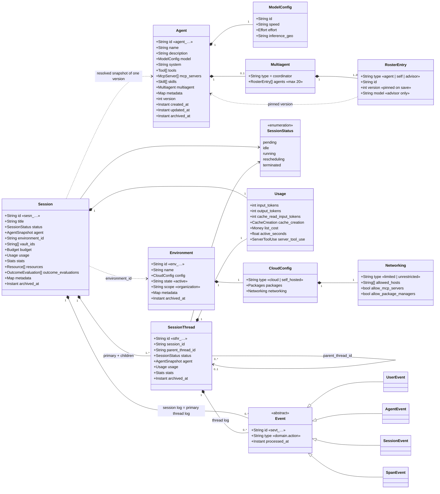

Design choices this model shows:

- **Configuration is versioned; the runtime takes a snapshot.** A session and each of its threads stores
  the fully resolved agent (`agent.version` included). Later agent updates never change a running
  session. A session can also apply overrides (`agent_with_overrides`) without creating a new agent version.
- **Environments are not versioned.** The docs advise keeping your own record of environment changes.
  The session keeps only `environment_id`, which can dangle (see §10).
- **Usage is tracked at two levels.** Each thread has `usage`, and the session's `usage` sums them
  (observed: coordinator thread 1 cent, reviewer thread 0, session total 2).

### 2.2 Observed resource fields

Fields marked ⚠ are present on the wire but absent from the pages listed above.

| Resource | Field | Observed value / note |
| --- | --- | --- |
| Environment | `state` ⚠ | `"active"` |
| Environment | `scope` ⚠ | `"organization"` |
| Environment | `config.packages` | Normalised to every manager (`pip`, `npm`, `apt`, `cargo`, `gem`, `go`) with empty arrays, `type: "packages"` |
| Environment | `config.networking` | `limited` with no hosts was echoed with all three flags explicit and `allowed_hosts: []` |
| Agent | `tools[].configs` ⚠ | Per-tool overrides, for example `{"name":"bash","type":"bash","enabled":true,"permission_policy":{"type":"always_ask"}}` |
| Agent | `tools[].default_config.enabled` ⚠ | `true` |
| Agent | `model` | String input is normalised to `{"id": …, "speed": "standard"}` (Haiku: no `effort` echoed) |
| Agent | `multiagent.agents[]` | `{type:self}` is stored as `{type:agent, id:<coordinator id>, version:<n>}`; references without `version` are pinned |
| Session | `title` ⚠, `type` ⚠ | `title` is free text, settable on create and update |
| Session | `stats` ⚠ | `{active_seconds, duration_seconds}` |
| Session | `usage` ⚠ | Token counters, `cache_creation.{ephemeral_5m,1h}_input_tokens`, `list_cost {amount:"<cents>", currency:"USD"}`, `server_tool_use` |
| Session | `resources` ⚠, `outcome_evaluations` ⚠ | Empty arrays in these tests |
| Session | `budget` | `null` when none was set |
| Thread | whole resource | `{id, type:"session_thread", session_id, parent_thread_id, status, agent:<snapshot>, usage, stats:{active_seconds, duration_seconds, startup_seconds}, archived_at, created_at, updated_at}` |

### 2.3 Identifier prefixes

| Prefix | Entity |
| --- | --- |
| `agent_` | Agent |
| `env_` | Environment |
| `sesn_` | Session |
| `sthr_` | Session thread |
| `sevt_` | Event (also used as `tool_use_id`) |
| `page_` | Opaque list cursor |
| `req_` | Request id (in error bodies and the `request-id` header) |

---

## 3. Endpoint map

Base URL `https://api.anthropic.com`. All calls send `x-api-key`, `anthropic-version` and `anthropic-beta`.
**Status** is what we observed.

| Method | Path | Purpose | Status / notes |
| --- | --- | --- | --- |
| POST | `/v1/environments` | Create environment | 200 |
| GET | `/v1/environments` · `/{id}` | List / retrieve | 404 after delete |
| POST | `/v1/environments/{id}/archive` | Archive (read-only; existing sessions continue) | 404 on a deleted env |
| DELETE | `/v1/environments/{id}` | Delete | 200 `{"type":"environment_deleted"}`, **even with idle sessions still referencing it** |
| POST | `/v1/agents` | Create agent (version 1) | 200 |
| POST | `/v1/agents/{id}` | Update; optional `version` for optimistic concurrency | 200 new version · 409 stale version · no-op keeps the version |
| GET | `/v1/agents/{id}/versions` | Version history | 200, newest first, `next_page`/`prev_page` |
| POST | `/v1/agents/{id}/archive` | Archive; irreversible | 200 with `archived_at` |
| POST | `/v1/sessions` | Create (optional `initial_events`, overrides, `budget`, `vault_ids`, `title`, `metadata`) | 200; `status:"running"` when `initial_events` is non-empty |
| GET | `/v1/sessions` | List; `agent_id`, `limit`, `page`, `order`, `include_archived` | Archived sessions hidden unless `include_archived=true` |
| GET | `/v1/sessions/{id}` | Retrieve | 404 after delete |
| POST | `/v1/sessions/{id}` | Update `title`, `metadata` (merged), `agent.tools`, `agent.mcp_servers`; idle only | 200, emits `session.updated` |
| POST | `/v1/sessions/{id}/archive` | Archive; idle (or pending) only | 200, `status → terminated` |
| DELETE | `/v1/sessions/{id}` | Delete record, events and sandbox | 200 `{"type":"session_deleted"}`; 400 while running |
| POST | `/v1/sessions/{id}/events` | Send user and system events (batch) | 200, echoes events with server ids |
| GET | `/v1/sessions/{id}/events` | History; `types[]`, `limit`, `page`, `order` | Cursor paged |
| GET | `/v1/sessions/{id}/events/stream` | SSE live stream; `event_deltas[]` | No replay |
| GET | `/v1/sessions/{id}/threads` | List threads (primary included) | 200 |
| GET | `/v1/sessions/{id}/threads/{tid}` | Retrieve thread | 200 |
| GET | `/v1/sessions/{id}/threads/{tid}/events` | Thread history | 200 |
| GET | `/v1/sessions/{id}/threads/{tid}/stream` | Thread SSE stream | not exercised |
| POST | `/v1/sessions/{id}/threads/{tid}/archive` | Archive one thread; idle only | 200, thread `terminated`, emits `session.thread_status_terminated` |

Rate limits (docs): create endpoints 300 requests/minute and read endpoints 1,200 requests/minute, per
organization.

---

## 4. Lifecycles

### 4.1 Session status (state diagram)

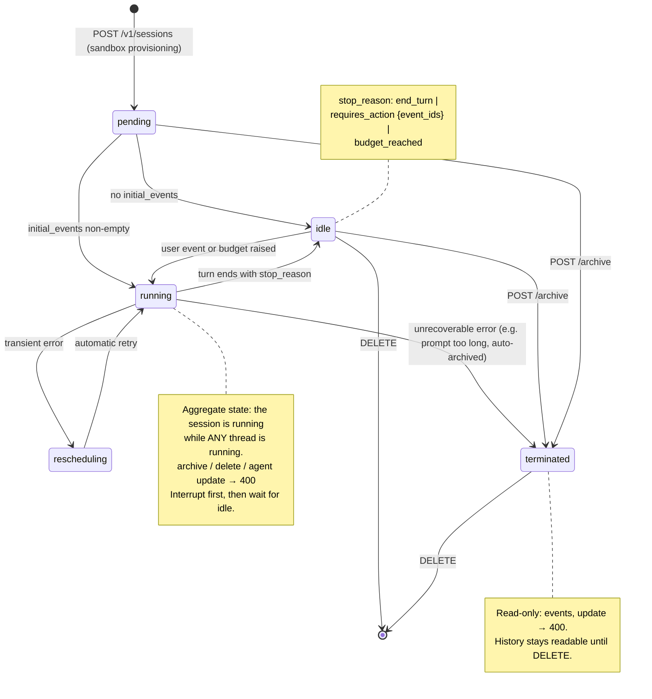

Observed behaviour:

- `pending` is real but undocumented. Archiving a running session returned *"Only pending or idle
  sessions may be archived."*
- The status doesn't change synchronously on `POST /events`. The posted events are queued with
  `processed_at: null`, and a `GET` right afterwards can still return `idle`. Clients should wait for
  `session.status_running` / `session.status_idle` events instead of polling `status`.
- `requires_action` and `end_turn` are both kinds of **idle**. The distinction lives in the
  `stop_reason`, which is an object rather than a string:
  `{"type":"requires_action","event_ids":["sevt_…"]}`.

### 4.2 Thread status (state diagram)

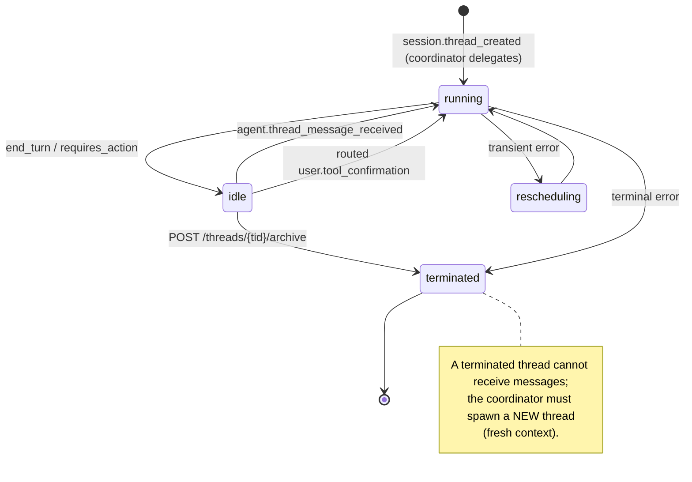

### 4.3 Agent and environment lifecycles

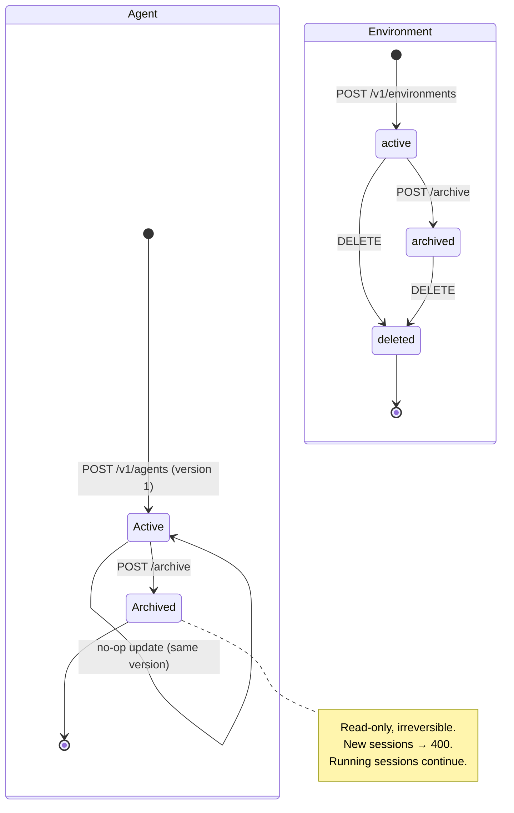

---

## 5. Event model

### 5.1 Envelope

```json
{ "id": "sevt_…", "type": "<domain>.<action>", "processed_at": "2026-10-06T19:29:49.060290Z", "...": "type-specific" }
```

- `processed_at` is `null` while an event is queued. The `POST /events` response echoes `id` and the
  content without `processed_at`.
- **`session_thread_id` appears only on thread lifecycle events** (`session.thread_*`). Messages
  between threads carry `to_session_thread_id` / `from_session_thread_id`, and blocking requests
  cross-posted to the primary thread carry `session_thread_id` (docs). All other events on a thread's log
  have no thread id (observed). The docs say every event has it.
- SSE frames look like `event: message\ndata: <json>\n\n`. The stream opens with a `: connected` comment.

### 5.2 Catalog

✔ = seen on the wire in this study.

| Type | Dir | Persisted | Key fields | Seen |
| --- | --- | --- | --- | --- |
| `user.message` | in | yes | `content[]` (text, image, document) | ✔ |
| `user.interrupt` | in | yes | `session_thread_id?` (one thread, or all threads) | ✔ |
| `user.tool_confirmation` | in | yes | `tool_use_id`, `result: allow\|deny`, `deny_message?` | ✔ |
| `user.custom_tool_result` | in | yes | `custom_tool_use_id`, `content[]` | |
| `user.tool_result` | in | yes | self-hosted environments only | |
| `user.define_outcome` | in | yes | `rubric` | |
| `system.message` | in | yes | privileged context; selected models only | |
| `agent.message` | out | yes | `content[]` | ✔ |
| `agent.thinking` | out | yes | progress signal only, no content | ✔ |
| `agent.tool_use` | out | yes | `name`, `input`, `evaluated_permission`, `evaluation` | ✔ |
| `agent.tool_result` | out | yes | `tool_use_id`, `content[]`, `is_error` | ✔ |
| `agent.mcp_tool_use` / `agent.mcp_tool_result` | out | yes | as above, for MCP | |
| `agent.custom_tool_use` | out | yes | client must answer | |
| `agent.thread_context_compacted` | out | yes | server-side context compaction | |
| `agent.thread_message_sent` | out | yes | `to_session_thread_id`, `to_agent_name`, `content[]` | ✔ |
| `agent.thread_message_received` | out | yes | `from_session_thread_id`, `from_agent_name`, `content[]` | ✔ |
| `session.status_running` / `_idle` | out | yes | `_idle`: `stop_reason`, `stop_details` | ✔ |
| `session.status_rescheduled` / `_terminated` | out | yes | | |
| `session.thread_created` | out | yes | `session_thread_id`, `agent_name` | ✔ |
| `session.thread_status_running` / `_idle` | out | yes | `session_thread_id`, `agent_name`, `stop_reason` | ✔ |
| `session.thread_status_terminated` | out | yes | emitted when a thread is archived | ✔ |
| `session.updated` | out | yes | only the changed fields | ✔ |
| `session.usage` | out | yes | cumulative `usage` (and `budget` echo) | ✔ |
| `session.error` | out | yes | `error` with `retry_status` | |
| `session.deleted` | out | stream | closes the stream | |
| `span.model_request_start` | out | yes | | ✔ |
| `span.model_request_end` | out | yes | `model_request_start_id`, `is_error`, `model_usage` | ✔ |
| `span.outcome_evaluation_*` | out | yes | outcome loops | |
| `event_start` / `event_delta` | out | **no** | previews (`event_deltas[]` opt-in) | ✔ |

### 5.3 What one turn looks like (activity diagram)

The order below was observed for every turn. It is the "grammar" a client parser can rely on.

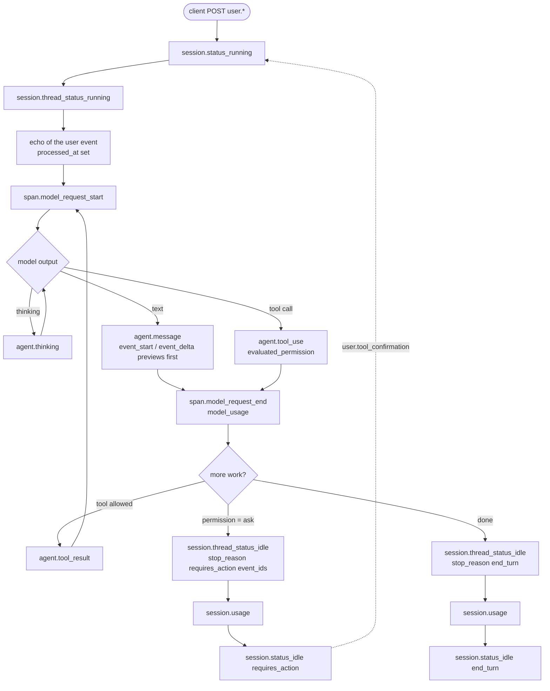

---

## 6. Interaction sequences

### 6.1 Create, stream and converse

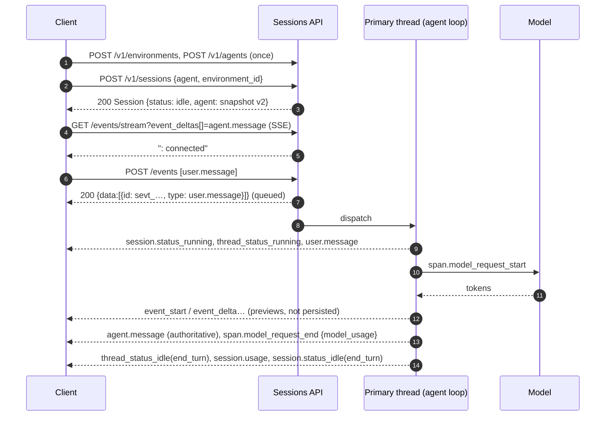

### 6.2 Human in the loop: tool confirmation

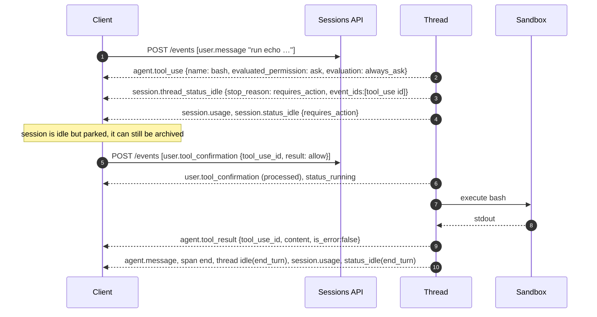

### 6.3 Interrupt and redirect

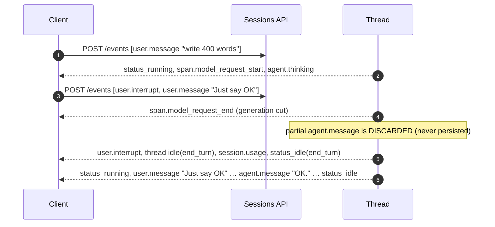

### 6.4 Multi-agent delegation (asynchronous mailbox)

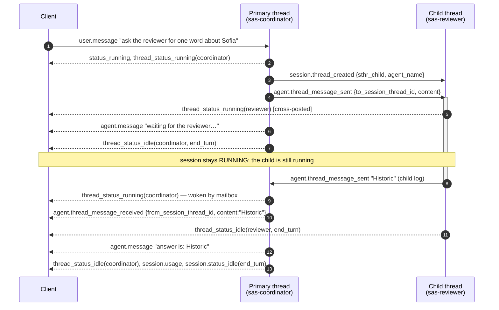

The child's own log (`GET /threads/{child}/events`) starts with `session.thread_status_running` and then
`agent.thread_message_received` (the task from the coordinator). It ends with
`agent.thread_message_sent` to the primary thread. The child never sees the user's message.

### 6.5 Thread persistence and archive

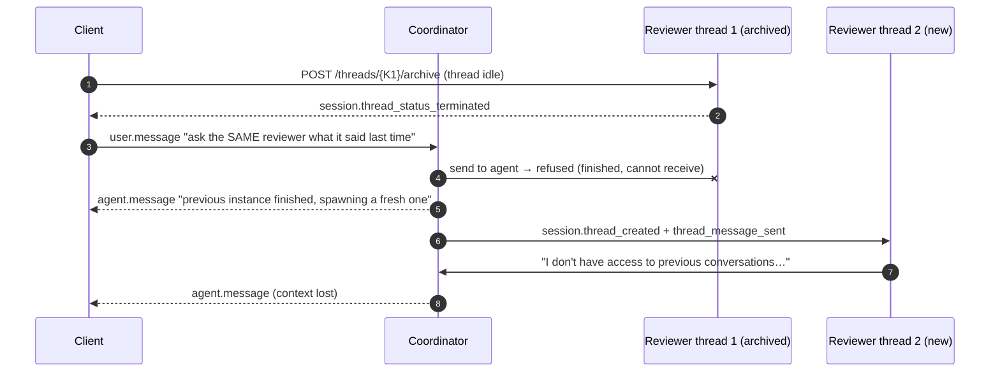

Threads are the unit of memory. An unarchived child keeps everything from its earlier turns, so a
follow-up reaches the same thread. Archiving a child frees one of the 25 concurrent-thread slots, but
its context can't be recovered for later delegations.

### 6.6 Reconnecting without missing events

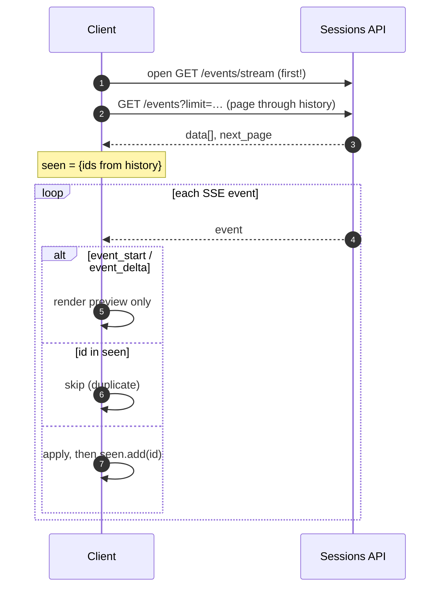

---

## 7. Multi-agent architecture details

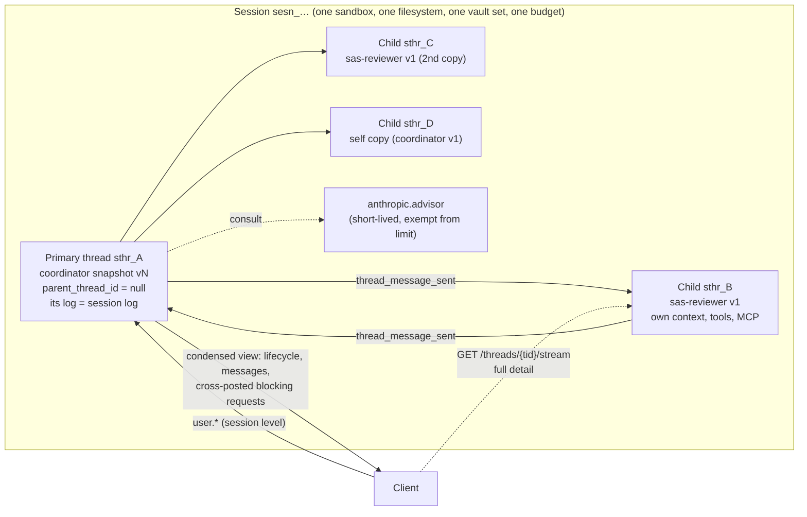

| Rule | Value | Source |
| --- | --- | --- |
| Roster size | ≤ 20 unique agents, many copies of each | docs |
| Depth | 1. A roster member with its own roster fails: *"maximum depth is 1"* (400) | observed |
| Concurrent threads | ≤ 25 (advisor exempt); archive idle threads to free slots | docs |
| Roster versions | Resolved and pinned when the coordinator is saved; `self` becomes the coordinator's own id/version | observed |
| Sharing | Sandbox, filesystem, vault credentials and budget are shared. Context, tools and MCP servers are per agent | docs |
| Session status | Aggregate: `running` while any thread runs | observed |
| Blocking requests | A child's tool confirmation or custom tool call is cross-posted to the primary thread with `session_thread_id`; the reply is routed automatically | docs |
| Interrupt | `user.interrupt` with `session_thread_id` stops one thread; without it, every non-archived thread | docs |
| Inter-thread messaging | Shows up only as `agent.thread_message_*` events; no `agent.tool_use` is emitted for the delegation itself | observed |

---

## 8. Reading the log: stream vs history

| Concern | Live stream (`/events/stream`) | History (`/events`) |
| --- | --- | --- |
| Replay | None. Only events after connecting (observed) | Full |
| Previews | `event_deltas[]=agent.message` → `event_start` and `event_delta` chunks; `agent.thinking` gets `event_start` only | Never |
| Filtering | — | `types[]=…` (repeatable) |
| Ordering | Arrival | `order=asc` (default) or `desc` |
| Paging | — | `limit` + opaque `page` cursor (`page_…`); on events, `prev_page` stayed `null` on page 2 (forward-only) |
| Per thread | `/threads/{tid}/stream` | `/threads/{tid}/events` |
| Single-agent session | — | Primary-thread history is identical to session history (observed) |

Session listing also hides archived sessions unless `include_archived=true` (observed).

---

## 9. Observed errors

All error bodies have the shape `{"type":"error","error":{"type":"…","message":"…"},"request_id":"req_…"}`.

| Call | Status | `error.message` |
| --- | --- | --- |
| Update agent with stale `version` | 409 | Concurrent modification detected. Please fetch the latest version and retry. |
| Update archived agent | 400 | Cannot modify archived agent |
| Create session from archived agent | 400 | agent … is archived and cannot be used to create a session |
| Coordinator roster containing a coordinator | 400 | Agent has invalid configuration: subagent … has its own subagents; maximum depth is 1 |
| Archive running session | 400 | Session … cannot be archived while its status is "running". Only pending or idle sessions may be archived. |
| Delete running session | 400 | Cannot delete session while it is running. Send an interrupt event or wait for the session to complete. |
| Send events to archived session | 400 | Cannot send events to archived session: … |
| Update archived session | 400 | Cannot modify archived session |
| Retrieve deleted environment / session | 404 | Environment … not found. (`not_found_error`) |

---

## 10. Docs vs wire

| # | Docs or blog | Wire (2026-10-06) |
| --- | --- | --- |
| 1 | Every persisted event includes `session_thread_id` | Only `session.thread_*` events carry it; messages carry `to_`/`from_session_thread_id` |
| 2 | Delete an environment "only if no sessions reference it" | Delete succeeded with two idle sessions referencing it; they kept a dangling `environment_id` |
| 3 | Statuses: `idle`, `running`, `rescheduling`, `terminated` | `pending` also exists (in the archive error text) |
| 4 | Archive emits `session.status_terminated` (reference) | Not in the history read right after archiving a session. Thread archive did emit `session.thread_status_terminated` |
| 5 | Session list filters | `include_archived` exists; archived sessions are hidden by default |
| 6 | Resource fields | Undocumented: session `title`, `stats`, `usage`, `resources`, `outcome_evaluations`; environment `state`, `scope`; tool `configs[]` |
| 7 | Interrupt stops the model response | The partial `agent.message` is dropped; only the span end and `user.interrupt` are persisted |
| 8 | Blog: containers are provisioned lazily by the brain, *"only if they are needed"* | Session docs: the sandbox *"begins provisioning as soon as the session is created"*; thread `stats.startup_seconds` was `0`. The docs describe the current product |
| 9 | Blog: `getEvents()` returns positional slices and can rewind before a given moment | The public `/events` offers a forward cursor, a type filter and an order, with no "before event X" window |
| 10 | Core docs: *"if you approach max context, the API automatically condenses session history"* | No compaction on Haiku 4.5 or Sonnet 5.5 when user messages grew the context. The overflow ended in a terminal `session.error`, and the session was auto-archived (§11.4) |

---

# Part II: Architecture behind the API

## 11. Architecture behind the API (engineering blog)

The engineering post *Scaling Managed Agents* (2026-04-08) describes how the platform is built. Its central
claim: separate the **brain**, the **hands** and the **session** so each can fail, scale or be replaced
on its own. Section 11.2 checks each internal interface against what we saw on the wire. Rows marked
*inference* are our reading and were not proven by a test.

### 11.1 Components (component diagram)

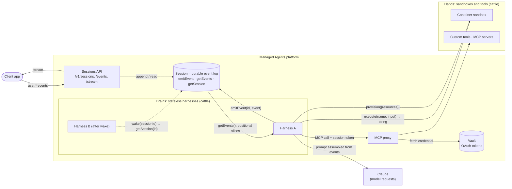

Design principles, quoted from the post:

- *"Because the session log sits outside the harness, nothing in the harness needs to survive a
  crash."* A failed harness is replaced: `wake(sessionId)`, `getSession(id)`, then it "resume[s] from
  the last event".
- The session is *"a context object that lives outside Claude's context window."* Compaction and memory
  files are *"irreversible decisions about what to keep"*. The log keeps everything, and the harness
  transforms events before sending them to Claude, for example *"context organization to achieve a high
  prompt cache hit rate and context engineering."*
- `getEvents()` lets the brain *"pick up from wherever it last stopped reading, rewinding a few events
  before a specific moment to see the lead up."*
- Hands are just tools: *"The harness doesn't know whether the sandbox is a container, a phone, or a
  Pokémon emulator."* Brains can connect to many hands and *"pass hands to one another."*
- Credentials never enter the sandbox. Git tokens are wired in at sandbox initialization, and MCP calls go
  through a proxy that looks up OAuth tokens in a vault using a token tied to the session.
- Taking the harness out of the container cut time to first token by about 60% at p50 and over 90% at p95.
- The platform aims to be *"opinionated about the interfaces around Claude"* but *"unopinionated about
  the specific harness"*.

### 11.2 Internal interfaces vs wire evidence

| Internal interface (blog) | Public surface / wire evidence | Confidence |
| --- | --- | --- |
| `emitEvent(id, event)`: harness appends to the log | Every persisted event has a server `id` and `processed_at`. `span.model_request_*` and `session.usage` are the harness's own bookkeeping events | observed |
| `getEvents()`: positional slices, rewind | `GET /events` with `types[]`, `limit`, a forward cursor and `order=asc\|desc`. No "N events before event X" read is exposed | observed: the public API is narrower than the internal one |
| `getSession(id)` + `wake(sessionId)`: crash recovery | The `rescheduling` status and the `session.status_rescheduled` event ("transient error, retrying automatically") are where a harness restart would show up | inference |
| Harness transforms events before calling Claude | `agent.thread_context_compacted` is in the catalog. Growth driven by user messages did not trigger it on Haiku 4.5 or Sonnet 5.5 (§11.4) | observed: no compaction in our tests |
| `execute(name, input) → string` | `agent.tool_use` → `agent.tool_result {content, is_error}` (observed). The sandbox is reached as a tool | observed |
| `provision({resources})`: containers provisioned lazily by tool call | The session docs say the sandbox *"begins provisioning as soon as the session is created"*. The thread `stats.startup_seconds` was `0` | **blog vs docs conflict**; docs and wire win |
| Vault + MCP proxy | Session `vault_ids`, shared by all threads | docs |
| Many brains / pass hands | Multi-agent threads share one sandbox and filesystem but have separate contexts | docs + observed threads |

### 11.3 Crash recovery as described by the blog (sequence diagram)

This flow can't be observed from outside. It explains why the API can promise a durable session with no
sticky server.

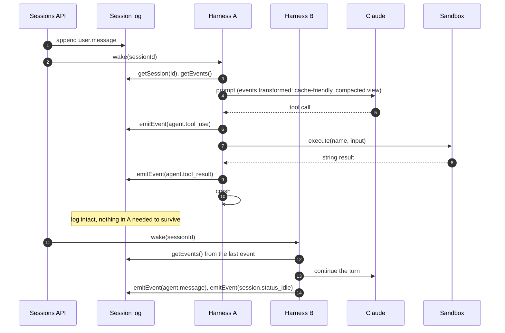

### 11.4 Compaction experiment (2026-10-07)

**Question:** does the harness keep a compaction as temporary harness state, or recompute it before
every model call? We tried to trigger one and watch the log.

**Setup.** Each agent had no tools and a system prompt telling it to answer `ACK <n>`. Its sessions had
a hard `budget`. Each turn sent one synthetic "log page" as a `user.message`. Page 1 also planted a
codeword so recall could be tested after compaction. After every turn we read `span.model_request_end`
and searched the history for `agent.thread_context_compacted`.

| Model (window) | Page size | Context sent per turn (cache read + cache write) | Outcome |
| --- | --- | --- | --- |
| Haiku 4.5 (200K) | ~78K tokens | 78K → 156K | Turns 1–2 fine, no compaction |
| | | 234,011 (turn 3) | `session.error` *"prompt is too long: 234011 tokens > 200000 maximum"*, `retry_status: terminal` |
| Sonnet 5.5 (1M) | ~170K tokens | 171K → 341K → 511K → 681K → 851K | Turns 1–5 fine, no compaction (cache reads grew linearly; the full history was re-sent every turn) |
| | | 1,021,986 (turn 6) | `session.error` *"prompt is too long: 1021986 tokens > 1000000 maximum"*, `retry_status: terminal` |

**Observed:**

- **No `agent.thread_context_compacted` event was ever emitted.** Not at 171K, which is above the
  Messages API default trigger of 150K, and not at 851K (85% of the window).
- **Every turn re-sent the full, unchanged history,** shown by `cache_read_input_tokens` equal to the
  previous turn's total. Nothing was summarized or trimmed.
- **Overflow is fatal.** The failing request recorded a span with zero usage and cost nothing. The
  terminal error then moved the thread and the session to `terminated`, and set **`archived_at`
  automatically**. Further events were rejected with *"Cannot send events to archived session"*.

**Interpretation, as inference:** in this API version, compaction did not fire for growth driven by
user messages, even when the next request plainly would not fit. Possible explanations:

1. It runs only between model calls inside an agentic loop, as tool results accumulate.
2. It uses a threshold above 85% that a single 170K jump overshot.
3. It isn't enabled for these models or for agents without tools.

Either way, a client cannot rely on the platform to rescue an oversized conversation. Size the
messages, or split the work across threads or sessions. On the original question, whether a compaction
is kept or recomputed, this experiment is **inconclusive** because no compaction happened. The
documented design argues for "computed once and persisted": the Messages API returns the summary as
a `compaction` block the client must keep, and the stateless harness can only resume from the log.
§11.6 settles it with first-party evidence from Claude Code's own transcripts.

### 11.5 What the linked posts add

| Post | Guidance relevant to sessions and multi-agent work |
| --- | --- |
| Effective context engineering | *"The art of compaction lies in the selection of what to keep versus what to discard."* *"Tool result clearing"* is *"one of the safest lightest touch forms of compaction."* Sub-agents *"return only a condensed, distilled summary of [their] work (often 1,000-2,000 tokens)."* Keep lightweight identifiers in context and load the data just in time |
| Effective harnesses for long-running agents | An initializer agent and coding agents hand state over through artifacts: a progress file, git history, a feature list and `init.sh`. Each new context *"begins with no memory of what came before"* |
| Harness design for long-running apps | Planner, generator and evaluator agents that talk *"via files"*. Context resets with a handoff artifact vs compaction. *"Context anxiety"*. *"Every component in a harness encodes an assumption about what the model can't do on its own"*, and those assumptions go stale as models improve |
| Recursive Language Models (arXiv 2512.24601) | Treating context as an object outside the window, which the model reads recursively. This is the research basis for the session-as-context-object idea |

The wire agrees with the condensed-summary pattern. On the primary thread, the coordinator received only the
child's final message (`agent.thread_message_received` with content `"Historic"`), while the child's
reasoning and spans stayed on the child thread's log (observed, §6.4).

### 11.6 Compaction as a projection: how Anthropic's harnesses persist it

Four sources, the strongest first, answer whether a compaction mutates the log or is kept as harness
state. The answer is neither: the log is append-only, and the compaction is appended as a record that
*defines a view*.

**Claude Code transcripts** (first-party, read on disk on 2026-10-12, `~/.claude/projects/*/*.jsonl`).
One session of 23,362 lines holds 7 compactions, each taking about 1,000,000 tokens to 10,000–25,000.
Each compaction appends:

1. A `system` record with `subtype: "compact_boundary"`, `parentUuid: null` (it starts a new chain) and
   `logicalParentUuid` pointing at the last pre-compaction record. Its `compactMetadata` carries
   `trigger` (`auto`), `preTokens`, `postTokens`, `cumulativeDroppedTokens`, `durationMs`,
   `preCompactDiscoveredTools`, and `preservedSegment {headUuid, anchorUuid, tailUuid}` plus
   `preservedMessages.uuids`: the ids of the recent messages kept verbatim after the summary.
2. A `user` record with `isCompactSummary: true` whose `parentUuid` is the boundary, holding the summary
   text ("This session is being continued from a previous conversation that ran out of context…").

The 2,630 records before the first boundary are untouched: no flag, no deletion, no reordering. On
resume, the harness rebuilds context from the newest boundary: summary, then the preserved ids, then
everything after. The [Agent SDK](https://code.claude.com/docs/en/agent-sdk/agent-loop) surfaces the same
record as a `compact_boundary` system message and offers a `PreCompact` hook "to archive the full
transcript", which only makes sense because the transcript itself is never rewritten.

**Messages API** ([on demand](https://platform.claude.com/docs/en/build-with-claude/compaction-on-demand),
[threshold](https://platform.claude.com/docs/en/build-with-claude/compaction-threshold)). The summary is a
signed, readable `compaction` block. It goes *first* in `messages`; *"the API drops what came before the
block"*. *"Compact again"* summarizes the previous summary plus everything after it, and only the newest
block is sent. A compaction request is refused while the last assistant turn has an unanswered tool call.

**Managed Agents.** `agent.thread_context_compacted` is a persisted event with `pre_compaction_tokens`.
The engineering post says the log keeps everything because discarding is *"irreversible"*, and the
harness *"transforms"* events into the prompt per call.

**Others agree.** The [ACP session-compaction RFD](https://agentclientprotocol.com/rfds/session-compaction)
models a compaction as a timeline entity, *"not a conversation message"*, and clients *"must retain"*
history. [Open Managed Agents](https://github.com/openma-ai/open-managed-agents) handles the
*"compaction-summary boundary"* inside its `eventsToMessages` projection over a `seq`-ordered log.
[Agdi](https://cdn.jsdelivr.net/npm/agdi@2026.5.9/docs/concepts/compaction.md) builds requests from
the summary plus *"the messages after the compaction point"*. The
[Convex agent library](https://github.com/get-convex/agent/pull/287) stores the Anthropic compaction block
as an ordinary message part and replays it.

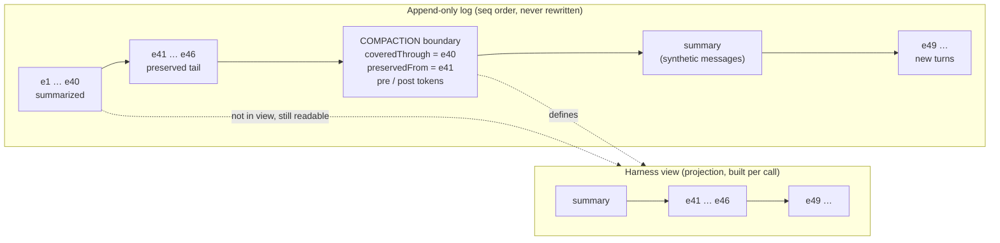

What this means for a session library: triggers and strategies are harness policy and stay outside the
log; the *result* is persisted, as an appended boundary plus its summary; the prompt view is computed
from the newest boundary; nothing already written is flagged, moved or deleted.

---

---

## Appendix A: Captured samples (trimmed)

Thread idle waiting for a confirmation:

```json
{"type":"session.thread_status_idle","id":"sevt_01Q8wEe4meeGu2Bf34su4xjw",
 "agent_name":"sas-explore-worker","session_thread_id":"sthr_01Q9Vb7nKoK7JmxpSXC9wYae",
 "stop_details":null,"stop_reason":{"type":"requires_action","event_ids":["sevt_01RDGG4KZH5RQdYptoebDaUr"]}}
```

Tool use evaluated as `ask`:

```json
{"type":"agent.tool_use","id":"sevt_01RDGG4KZH5RQdYptoebDaUr","name":"bash",
 "input":{"command":"echo hello-from-sandbox"},
 "evaluated_permission":"ask","evaluation":{"type":"always_ask"}}
```

Model-call span with usage:

```json
{"type":"span.model_request_end","id":"sevt_01KL8Uaa1WTgmgvDky1PNPqP","is_error":false,
 "model_request_start_id":"sevt_019GZqgeZhvohKBA9znZp2b9",
 "model_usage":{"cache_creation_input_tokens":4952,"cache_read_input_tokens":0,"input_tokens":10,"output_tokens":55}}
```

Inter-thread messages, primary-thread view:

```json
{"type":"agent.thread_message_sent","to_agent_name":"sas-reviewer",
 "to_session_thread_id":"sthr_011QWt9yuY5bohkKPjw2t9mr",
 "content":[{"type":"text","text":"Provide one word that describes the city of Sofia."}]}
{"type":"agent.thread_message_received","from_agent_name":"sas-reviewer",
 "from_session_thread_id":"sthr_011QWt9yuY5bohkKPjw2t9mr",
 "content":[{"type":"text","text":"Historic"}]}
```

Streamed preview chunk (not persisted):

```json
{"type":"event_delta","event_id":"sevt_01PQbRG2rZyuaasGdaZNYWPy",
 "delta":{"type":"content_delta","index":0,"content":{"type":"text","text":" output"}}}
```
