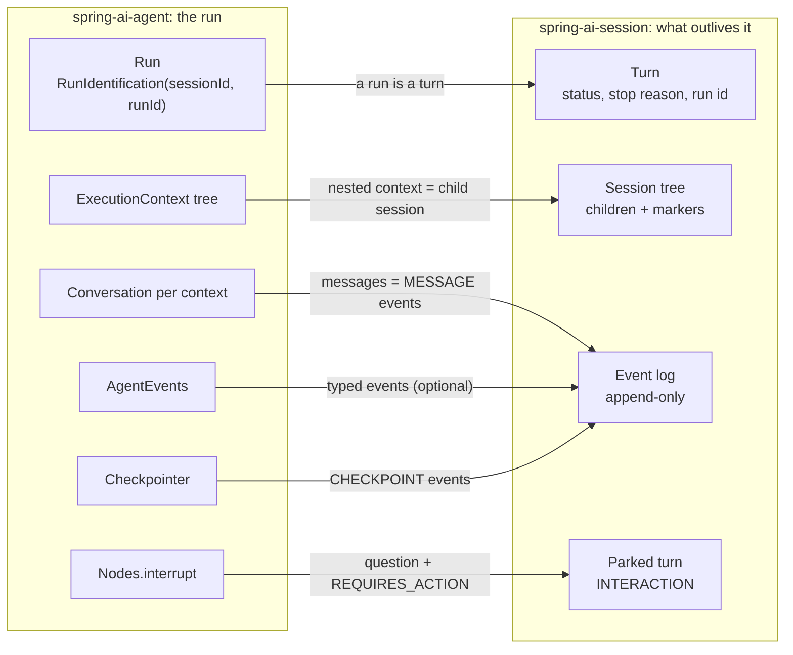
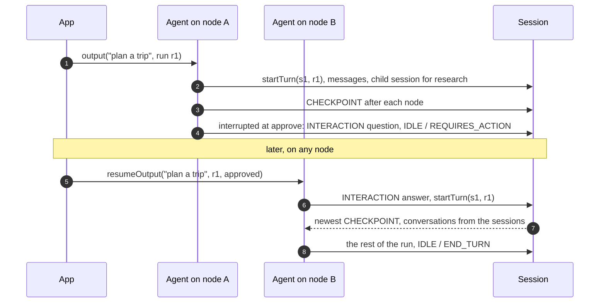

# Spring AI Session with spring-ai-agent

This is the follow-up to [the new session design](spring-ai-new-session-design.md). That one is about
the session itself and the `ChatClient` integration. This one shows how the same session serves the
new spring-ai-agent runtime: agents, execution contexts, features and events.

The question I started with: can one session layer serve both ways of building agents, `ChatClient`
with advisors (and agent-utils on top) and spring-ai-agent, without bending one to fit the other?
The answer is yes. It took a few changes in the session, all of them already in the new design, and a
new module, `spring-ai-session-agent`, that plugs into spring-ai-agent as features. It's implemented
and tested on the same branch stack, against a local spring-ai-agent snapshot.

Contents:

1. [In one page](#1-in-one-page)
2. [Who owns what](#2-who-owns-what)
3. [How a run maps onto a session](#3-how-a-run-maps-onto-a-session)
4. [Using it](#4-using-it)
5. [What changed in the session to make this work](#5-what-changed-in-the-session-to-make-this-work)
6. [Things to know](#6-things-to-know)
7. [Four asks of spring-ai-agent](#7-four-asks-of-spring-ai-agent)
8. [Open points](#8-open-points)

---

## 1. In one page

- **A run is a turn.** The run starts the session's turn and ends it with a stop reason. The run id is
  recorded on the turn, so the log says which run wrote what.
- **The conversation is the log.** The main conversation is stored as `MESSAGE` events and restored
  from the session's active view, compaction included. Message ids are derived from the run, so a
  re-attempted run appends nothing twice.
- **Nested agents are child sessions.** Each nested execution context gets its own session in the
  tree, and the parent's log records what it sent and got back.
- **Agent events are stored as typed events, optionally.** Node, model call, tool call and custom
  events get their own types. The core doesn't need them; the `ChatClient` path doesn't write them.
- **An interrupt parks the turn.** `Nodes.interrupt` becomes a question in the log, and any instance
  can resume the run with the answer.
- **The log is the checkpoint store.** A `Checkpointer` over the log means one store for memory,
  resume, replay and the live stream, with no conversation stored twice.
- **The same budget and tool confirmation.** `BudgetFeature` and `ToolConfirmationFeature` are twins
  of the two advisors, built on the same core classes.

---

## 2. Who owns what

The two projects overlap at the conversation, but they don't conflict. They own different things:

- **spring-ai-agent owns the run.** An `ExecutionContext` tree, a `Conversation` per context in memory,
  features, a stream of events, checkpoints.
- **spring-ai-session owns what outlives the run.** The log, the tree, the status a client reads
  between runs, usage, the questions waiting for a person.

So the integration is a set of features on the agent side that write to the session, and read from
it when a run starts or resumes. Nothing in the runtime changes.



---

## 3. How a run maps onto a session

| spring-ai-agent | In the session |
| --- | --- |
| `RunIdentification.sessionId()` | The root session: created on the first run, restored from its active view on every later one |
| A run | A turn: `startTurn(sessionId, runId)` when it starts, `endTurn` with `END_TURN`, `ERROR` or `REQUIRES_ACTION` when it ends |
| The main `Conversation` | `MESSAGE` events of the root session |
| A nested context (`Nodes.agent`, an agent used as a tool) | A child session |
| What a nested agent receives and answers | `MESSAGE_SENT` and `MESSAGE_RECEIVED` on the parent |
| Node, model call and tool call events | `NODE`, `MODEL_CALL`, `TOOL_CALL`; a completed model call is a `USAGE` event |
| An application's own `AgentEvent` | An `AGENT.<NAME>` event with its fields as the payload |
| `Nodes.interrupt(..)` | An `INTERACTION` question and the turn parked with `REQUIRES_ACTION` |
| A cancelled run | An `INTERRUPT` event and the turn ended with `INTERRUPTED` |
| Checkpoints | `CHECKPOINT` events of the root session |
| Streamed model chunks | Not stored: the run streams them, the session keeps what's left |

### 3.1 A run is a turn

`startTurn` is a compare-and-set, so two runs can't interleave on one session, exactly as for two
`ChatClient` calls. Both status events carry the run id.

Two rules came out of building it. A run ends a turn only when the turn is its own, so a run that
fails to start on a busy session never ends the other run's turn. And a crashed attempt leaves the
session `RUNNING`; when the same run is attempted again, it first ends the abandoned turn as
`INTERRUPTED`, then starts a new one.

### 3.2 The conversation is the log

The main conversation goes through a `ConversationInterceptor`: every update appends the new messages
as `MESSAGE` events. When a run starts on an existing session, the conversation is reset to the
session's active view, so a compacted session stays compacted.

Message ids are derived from the run, the path in the run, the position and a digest of the content.
A re-attempt that appends the same message again appends nothing, because a store ignores an id it
already holds. A re-attempt that produces a different message at the same position stores the new one.
The earlier `SessionFeature` used random ids, which is why it appended twice on re-attempts. Stable
ids are also what makes the log safe to use as the checkpoint store.

Compaction is optional and runs after each update, best effort: a failed compaction never fails the
run.

### 3.3 Nested agents are child sessions

A nested execution context becomes a child session named after its parent and its path
(`trip-1/research`), created on the first event from that path. The four propagation modes map like
this:

| Propagation | Child session |
| --- | --- |
| `SHARED` | None: it writes to its parent's session |
| `DELEGATED` (default) | A child, plus `MESSAGE_SENT` with the request and `MESSAGE_RECEIVED` with the answer on the parent |
| `FORKED` | A child; nothing goes back |
| `ISOLATED` | A child that starts empty |

A child's log is self-contained: it starts with the messages the nested conversation began with (a
fork of the parent's, or a seed), then the nested agent's own. A resume reads one session, and the
checkpointer needs no per-mode logic. The cost is the forked prefix stored once per child.

Graphs nest deeper than the session's default of one level, so raise
`DefaultSessionService.builder().maxTreeDepth(..)` to match.

### 3.4 Agent events, optionally

Node, model call and tool call events are stored with their own types, and an application's own
`AgentEvent` records as `AGENT.<NAME>` events. That's what lets a UI show what happened inside a run
from the session alone. None of it is needed for memory or resume. A completed model call is a
`USAGE` event, the same one the `ChatClient` path writes, so usage and budgets work the same way in
both worlds.

### 3.5 Interrupts park the turn

`Nodes.interrupt(..)` throws an `InteractionRequiredException`, and the run ends with a
`RunInterruptedEvent`. The feature turns it into the session's parked turn: an `INTERACTION` question
with the path and the payload, and the turn ended with `REQUIRES_ACTION`. That's the same protocol the
`ChatClient` tool-confirmation gate uses.

`resumeOutput(input, runId, answer)` on any agent instance records the answer, starts the turn and
resumes the run where it stopped:



### 3.6 The log is the checkpoint store

I looked at two options. The checkpointer could stay beside the session with its own store, or the
log could absorb it. I went with the log:

- A `CHECKPOINT` event after each node and each tool round holds the resume state without the
  conversations, which are the sessions themselves.
- `SessionCheckpointer` implements the runtime's `Checkpointer` over the log: it reads the newest
  checkpoint of the run and rebuilds each level's conversation from the session of its path.
- One store gives memory, resume, replay and the live stream; no message is stored twice; a run resumes
  on another node with nothing but the session.

The checkpointer API doesn't change: `CheckpointerFeature` simply takes this `Checkpointer`.

### 3.7 Budget and tool confirmation

- `BudgetFeature` is a `ModelCallInterceptor`. Before every model call it checks the tree's usage
  against its budget, and once it's reached it ends the turn with `BUDGET_REACHED` and refuses the call.
  It's the same check `BudgetAdvisor` does, in the core.
- `ToolConfirmationFeature` is a `ToolCallInterceptor`. A gated call interrupts the run with the pending
  call as the question. Resume with a `ToolConfirmation`: an allowed call runs through the agent's own
  tools, a denied one answers the model with its message.

### 3.8 Following a session

`AgentRun.events()` is the live stream of one run on one node, model chunks included.
`SessionService.subscribe(sessionId)` is the live stream of what the session kept. stream-source's
reactor adapter turns one into the other:

```java
Source<SessionEvent> source = SourceAdapter.toSource(sessionService.subscribe(sessionId));
```

---

## 4. Using it

```java
SessionFeature feature = SessionFeature.builder(sessionService)
    .agent(AgentSnapshot.of("planner", "3", "claude-sonnet-5-5"))
    .compaction(new TurnCountTrigger(20), SlidingWindowCompactionStrategy.builder().maxEvents(40).build())
    .build();

Agent<String, String> agent = ModelAwareGraphAgent.builder(Graphs.toolCallLoop(), chatModel)
    .tools(new WeatherTools())
    .enable(feature)
    .enable(new CheckpointerFeature(feature.checkpointer()))   // the log is the checkpoint store
    .enable(new BudgetFeature(sessionService, BudgetPolicy.fixed(Budget.ofTotalTokens(200_000))))
    .enable(new ToolConfirmationFeature(ToolConfirmationPolicy.forTools("bash")))
    .build();

agent.output("I am planning a trip to Paris.", new RunIdentification("trip-1", "run-1"));
agent.output("Which city did I mention?", new RunIdentification("trip-1", "run-2"));  // remembers
```

The same `SessionService` can serve `ChatClient`s at the same time: same store, same tree, same
status, usage and stream.

---

## 5. What changed in the session to make this work

All of it is part of [the new design](spring-ai-new-session-design.md); this is what spring-ai-agent
needed from it:

- **Module split.** The core depends on `spring-ai-model` and Reactor only. The advisors went to
  `spring-ai-session-chatclient`, so the agent module doesn't pull in `ChatClient`.
- **An open event type.** `EventType` is a value with well-known constants instead of an enum, so the
  runtime's events are stored as what they are, and an application can add its own.
- **The run id on the turn.** `startTurn(sessionId, runId)`, carried on the status events.
- **One parked-turn protocol.** `park`, `resume` and `pendingInteraction` on the service, used by both
  the `ChatClient` gate and the agent's interrupts. Tool confirmation is one kind of question.
- **Shared value types in the core.** `Budget`, `BudgetPolicy`, `BudgetGuard` and
  `ToolConfirmationPolicy`, so the features and the advisors use the same code.
- **The agent on the child marker.** `CHILD_CREATED` carries the child's agent name, version and model,
  so a UI can label a child without a second read.

A review afterwards found duplication between the two integrations and removed it. That's where
`park` and `resume`, `BudgetGuard`, and "a completed model call is one `USAGE` event" came from.

---

## 6. Things to know

- **Don't put `SessionMemoryAdvisor` on a `ChatClient` inside a `ChatClientAgent`.** The agent already
  sends the whole conversation through the client, so the advisor would add the history a second time.
  The `SessionFeature` is the memory there.
- **Features are top-level only.** The runtime calls features on the top-level agent, so nested
  persistence works from the path every event carries. A feature enabled on a nested agent does
  nothing; the runtime's one-time warning about that could become an error.
- **Spring AI versions.** The session stack builds on 2.1.0-SNAPSHOT for message parts, while
  spring-ai-agent builds on 2.1.0-M1. The agent artifacts run on the snapshot unchanged; the upstream
  move aligns them.
- **An interrupted tool call reads as a failed one** in the `TOOL_CALL` events, because the runtime
  unwinds the call with the interruption. The confirmed call then reads as started and completed.
- **Finding the newest checkpoint reads every checkpoint of the session.** Fine for now; a paged read
  newest-first, or an index on the run id, would bound it.
- **Not released.** The module depends on a spring-ai-agent snapshot that isn't published yet.

---

## 7. Four asks of spring-ai-agent

Each is small, and each removes a workaround in the feature. None blocks the integration.

1. **The agent's identity on its context.** Today a nested context only has its path, so a child
   session is labelled with the node's name, and the root's snapshot has to be repeated on the feature.
   An `ExecutionContext.getAgent()` returning the `AgentDescription`, plus a version on the description
   and a model name from the `ModelAccessor`, would give the session a real snapshot.
2. **The resume type on an interruption.** `Nodes.interrupt` knows the type of the answer, but the
   exception and the event don't carry it. With it, the question in the log says what answers it, which
   a UI or another node needs to resume. It's also what checking the answer's type on resume needs.
3. **A non-consuming read of the resume value.** Today the feature consumes the value and sets it back
   to record it as the answer. A `peekResumeValue()`, or a `consumeResumeValue(type)` that leaves a value
   of another type in place, makes that one call.
4. **A unique path for an agent called as a tool.** An agent used as a tool runs under the tool's name,
   which repeats when the model calls it twice in a run, so both calls share one child session and a
   resume inside such a run fails. Naming the context after the tool and the call id
   (`weather#call-3`) gives every call its own child.

---

## 8. Open points

- **Where `spring-ai-session-agent` lives** after the upstream move: next to the session, or next to
  spring-ai-agent. The dependencies are the same either way.
- **The four asks** above.
- **Two cleanups** I deferred: record `TOOL_CALL` events only on failure (the messages already show the
  calls and results), and split the event recording out of `SessionFeature` so memory and observability
  are separate features, like the memory advisor and the gates on the `ChatClient` side.

The full history, including the alternatives I weighed and the phases it was built in, is in
`design/reports/spring-ai-agent-alignment-report.md` on the `design/managed-agents-report` branch.
