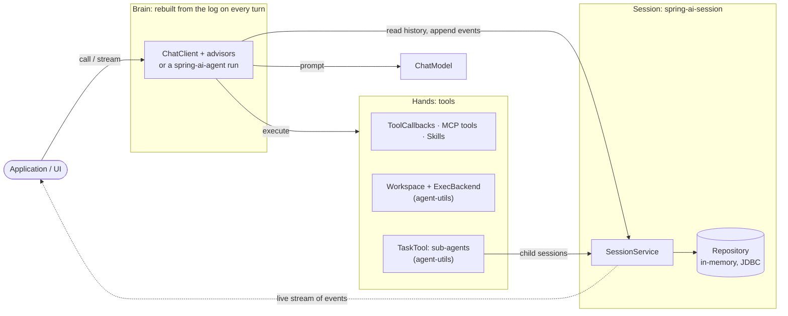
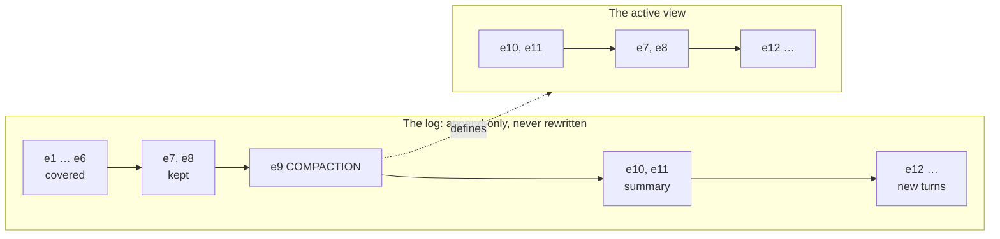
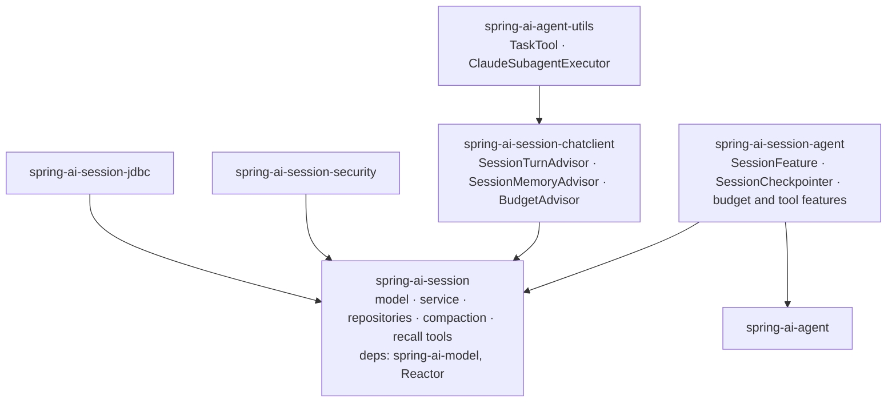
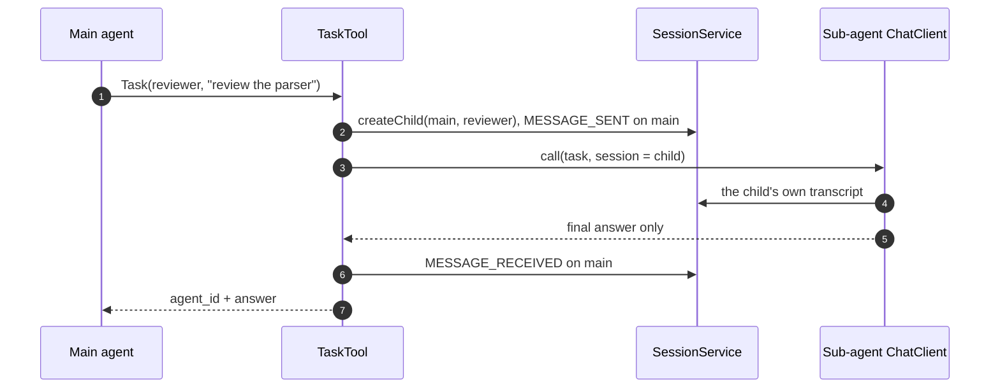

# Spring AI Session: the new design

This is the design behind the spring-ai-session refactoring for 0.11.0. Everything below is
implemented on a stack of branches, not released yet, and builds on Spring AI 2.1.0-SNAPSHOT.

For inspiration I used Anthropic's
[Scaling Managed Agents: Decoupling the brain from the hands](https://www.anthropic.com/engineering/managed-agents)
blog post and the design of the related agent APIs, plus how Claude Code and the Messages API persist
compaction. My notes on that are in [managed-agents-session-api.md](managed-agents-session-api.md),
for reference. I mapped the concepts onto what we already have in Spring AI (Session, Agent, Agent
Utils) and filled the gaps.

Contents:

1. [In one page](#1-in-one-page)
2. [Brain, hands, session](#2-brain-hands-session)
3. [What a session is now](#3-what-a-session-is-now)
4. [How it fits ChatClient, agent-utils and spring-ai-agent](#4-how-it-fits-chatclient-agent-utils-and-spring-ai-agent)
5. [Where each concept landed](#5-where-each-concept-landed)
6. [What changes for users](#6-what-changes-for-users)
7. [Open points](#7-open-points)

---

## 1. In one page

- **Message parts are the storage unit.** An event stores a message as its `List<MessagePart>`, using
  the parts' own JSON: text, reasoning with its signature, tool calls, tool results with `isError`,
  media. Nothing gets flattened to text anymore, so thinking blocks replay and attachments survive.
- **No more `userId`.** Principal handling works like Spring Session: a session has indexed metadata
  attributes with a well-known `principalName`. Who owns a session is the application's and Spring
  Security's call, not the session library's.
- **The log is append-only.** Compaction appends a boundary event and the summary; the active view is
  computed from the newest boundary. No archived flag, no summary injected into the log, no
  reordering.
- **One `Session` type for multi-agent.** A session has `parentSessionId` and `rootSessionId`, and the
  parent's log records what it delegated and what came back. That covers both a conversation and the
  sub-agent threads under it.
- **Session state lives in the log.** Turns with a status and a stop reason, token usage with a budget,
  a parked turn waiting for a person, interrupts, the agent snapshot, cursor reads and a live stream.
- **Additional events are optional.** The event type is open. spring-ai-agent records its own runtime
  events; the core needs none of them, and the ChatClient path writes none.
- **Three modules.** The core depends on `spring-ai-model` only. The ChatClient advisors
  are their own module, and so is the spring-ai-agent integration.

---

## 2. Brain, hands, session

The blog post splits an agent into three parts that can fail, scale and be replaced on their own:

- the **brain**, a stateless loop that calls the model;
- the **hands**, the tools and sandboxes it acts through;
- the **session**, a durable event log that lives outside both.

Nothing in the brain has to survive a crash: a new one reads the log and carries on. That maps
directly onto Spring AI:



What this buys us in practice:

- **Any node can serve the next turn.** The advisor chain keeps no state between calls, so a request
  can land on any instance that reaches the same store.
- **A crashed run re-attempts cleanly.** Event ids can be deterministic, and appending an id twice is a
  no-op, so replaying a run doesn't duplicate the conversation.
- **The log is the source of truth for the UI too.** Status, usage and questions waiting for a person
  are events, so a UI reads them the same way it reads messages.

---

## 3. What a session is now

### 3.1 Messages are stored as parts

Spring AI 2.1 changed messages: `UserMessage` and `AssistantMessage` hold an ordered
`List<MessagePart>` (`TextPart`, `ReasoningPart`, `ToolCallPart`, `ToolResultPart`, `MediaPart`), and
`getText()`, `getToolCalls()` and the new `getReasoning()` are views over it. Provider-owned data, such
as Anthropic's thinking signature, travels in an opaque payload.

The 2.1 upgrade notes warn that messages restored from a memory written by an earlier version lose
their thinking blocks. So the session stores the parts with their own JSON, not the text. That is also
what fixes attachments (#46) and keeps signed reasoning replayable. It's the main reason the stack
needs 2.1.

### 3.2 An append-only log of typed events

A session is a log of `SessionEvent`s. Most of them are messages; the rest record what happened
around the messages. Here is a real one, shortened, from a small travel-agent demo: the user asks for a booking,
the agent searches, then stops because booking costs money and needs a person to approve it. Another
process approves later.

```
  1 STATUS       RUNNING
  2 MESSAGE      USER Book the cheapest flight from Sofia to Amsterdam on 2026-11-20 ...
  3 MESSAGE      ASSISTANT calls findFlights{"from":"Sofia","to":"Amsterdam","date":"2026-11-20"}
  4 USAGE        881 tokens
  5 MESSAGE      TOOL findFlights -> "VX101 ... EUR 129, VX205 ... EUR 98, VX309 ... EUR 154"
  6 MESSAGE      ASSISTANT calls bookFlight{"flightId":"VX205","passenger":"Christian"}
  7 USAGE        1084 tokens
  8 INTERACTION  question: toolConfirmation
  9 STATUS       IDLE / REQUIRES_ACTION
 10 STATUS       RUNNING
 11 INTERACTION  answer: allowed=true
 12 MESSAGE      TOOL bookFlight -> "Booked VX205 for Christian. Confirmation code: QX7-5"
 13 MESSAGE      ASSISTANT I booked Christian on the cheapest flight, VX205. ...
 14 USAGE        1188 tokens
 15 STATUS       IDLE / END_TURN
```

The event types:

| Group | Types | Written by |
| --- | --- | --- |
| Conversation | `MESSAGE` | every integration |
| Turns | `STATUS`, `INTERRUPT`, `INTERACTION` | the memory advisor, the tool-confirmation gate, `interrupt` |
| Cost | `USAGE` | one per model call |
| Compaction | `COMPACTION` | the service, when it compacts |
| Sub-agents | `CHILD_CREATED`, `MESSAGE_SENT`, `MESSAGE_RECEIVED` | on the parent, when a child is used |
| Optional, per integration | `NODE`, `MODEL_CALL`, `TOOL_CALL`, `CHECKPOINT`, or your own `EventType.of("...")` | spring-ai-agent today |

Messages stay the primary thing. The prompt is built from `MESSAGE` events only, and compaction only
knows messages. Everything else is bookkeeping around them, and most of it is optional: an
application that wants plain chat memory can ignore it.

### 3.3 Compaction is a projection

Before, a compaction rewrote the log: it flagged old events `archived` and inserted the summary in
front of the kept ones. In JDBC that meant deleting and re-inserting the tail of the log, the most
fragile code we had.

Every Anthropic harness I looked at does it differently. The log is never rewritten; a compaction is
appended as a boundary that defines a view. Claude Code's transcripts and the Messages API's
compaction block both work this way. So now there are two things to keep apart:

- **The log** is everything that ever happened, in order. Nothing in it is changed or removed.
- **The active view** is what the model gets. It's computed from the newest boundary every time the
  history is read.

#### What a compaction writes

One `COMPACTION` event, plus the summary messages when the strategy writes a summary. The boundary
names, by event id, what the view starts with:

| In the boundary | Meaning |
| --- | --- |
| pinned | Events that always stay at the front: the stored system prompt, and an earlier summary when a window strategy runs after a summarizing one |
| summary | The summary messages appended right after the boundary; empty for the window strategies |
| preserved | The recent events kept as they are |
| covered count, tokens saved, strategy | What the pass did, for monitoring |

The view is then: pinned, summary, preserved, and everything appended after the boundary. Events the
boundary doesn't name are *covered*: still in the log, never sent to the model.

#### Example: a sliding window, no summary

A `SlidingWindowCompactionStrategy` with `maxEvents(4)`, after three turns (only the messages are
shown; the status and usage events in between don't take part):

```
log                                              view after the compaction
e1  USER       Plan a trip to Paris
e2  ASSISTANT  Here's a 3-day plan ...
e3  USER       Add a day in Lyon
e4  ASSISTANT  calls findTrains(Paris, Lyon)
e5  TOOL       TGV 08:04, 2h ...
e6  ASSISTANT  Lyon is 2 hours away by train ...
e7  USER       Book the hotel                    e7  USER       Book the hotel
e8  ASSISTANT  Done, Hotel du Louvre ...         e8  ASSISTANT  Done, Hotel du Louvre ...
e9  COMPACTION preserved [e7, e8], 6 covered     e10 ...the next turn
e10 USER       ...the next turn
```

- The window wants the last 4 events, which would start at `e5`, in the middle of the Lyon turn. A
  window never starts mid-turn, so it moves forward to the next user message, `e7`, and keeps only
  two. That's what keeps a tool call and its result together.
- The compaction wrote one event, `e9`. Nothing else was touched: `e1` to `e6` are still there, and
  the recall tools still find them.
- The model sees `e7`, `e8`, then everything after the boundary.

#### Example: with a summary

A `RecursiveSummarizationCompactionStrategy` makes the same kind of cut, then asks a model to
summarize the covered part. The summary is appended right after the boundary as a short synthetic exchange:

```
log                                              view after the compaction
e1 … e6    (as above)                            e10 USER       Summarize the conversation so far.
e7  USER       Book the hotel                    e11 ASSISTANT  We planned 3 days in Paris and a
e8  ASSISTANT  Done, Hotel du Louvre ...                        day in Lyon, by TGV ...
e9  COMPACTION summary [e10, e11],               e7  USER       Book the hotel
               preserved [e7, e8]                e8  ASSISTANT  Done, Hotel du Louvre ...
e10 USER       Summarize the conversation ...
e11 ASSISTANT  We planned 3 days in Paris ...
```

The summary comes after `e8` in the log, but before it in the view. Log order and view order differ
on purpose, and the log stays append-only.



#### Compacting again

The next compaction works on the current view, not on the whole log, and its boundary replaces the
previous one: the newest boundary wins. A window strategy running after a summary pins that summary,
so it stays at the front and the window applies to the real conversation only. A summarizing strategy
summarizes the previous summary together with what came after it.

#### The rules

- **Only messages.** Compaction reads the view, which is `MESSAGE` events only. Status, usage and the
  other events never enter it and are never summarized.
- **Whole turns.** A cut always starts at a user message, and the newest turn is always kept, even when
  it alone is bigger than the window.
- **No-op passes write nothing.** If nothing needs to leave the view, no event is appended.
- **The system prompt stays.** When system messages are stored (it's opt-in), the latest one is pinned
  at the front and older ones leave the view.
- **Nothing is lost.** Covered events stay in the log for recall, audit, or to rebuild any earlier
  view.
- **Safe and cheap.** The memory advisor compacts after a turn ends, never in the middle of a tool
  loop, and a failed compaction never fails the user's request. The boundary is appended with the
  session's version check, so if another writer got there first nothing is written and the next pass
  tries again. A compaction is one small insert; no row is ever rewritten.

#### Strategies and triggers

The trigger decides *when* to compact, the strategy decides *what* to keep. Both were there before;
only how the result is stored changed.

| Strategy | Keeps | Writes a summary |
| --- | --- | --- |
| `SlidingWindowCompactionStrategy` | the last N events (`maxEvents`) | no |
| `TurnWindowCompactionStrategy` | the last N turns (`maxTurns`) | no |
| `TokenCountCompactionStrategy` | the newest events within a token budget (`maxTokens`) | no |
| `RecursiveSummarizationCompactionStrategy` | a window, plus a model-written summary of the rest | yes |

Triggers: `TurnCountTrigger`, `TokenCountTrigger`, and `CompositeCompactionTrigger` to combine them.

```java
SessionMemoryAdvisor.builder(sessionService)
    .compactionTrigger(new TurnCountTrigger(20))
    .compactionStrategy(SlidingWindowCompactionStrategy.builder().maxEvents(40).build())
    .build();
```

An existing 0.10 log needs no migration step. It's read as before until its first 0.11 compaction
appends the first boundary.

### 3.4 No `userId`: scope works like Spring Session

`Session.userId` was required, indexed, and the only way to find a user's sessions. Two things were
wrong with it. It modelled an application concern: who owns a session (a user, a tenant, a team) is
the application's decision. And it authorized nothing: any caller that knew a session id could read
and write it.

Spring Session solved this long ago, and I followed it:

- **The store only indexes.** A session has metadata, some of it indexed, with a well-known
  `principalName` attribute. `findByIndex(name, value)` replaces `findByUserId`.
- **The application fills it.** A `SessionScopeResolver` adds attributes to every session the service
  creates. The security module's resolver reads the principal from Spring Security.
- **Spring Security decides.** The optional `spring-ai-session-security` module wraps the service in an
  `AuthorizingSessionService` that asks an `AuthorizationManager<Session>` before every read and write.
  The default allows a principal its own sessions; replace it for tenants or admin roles.
- **Recall takes a selector.** The cross-session recall tools search the sessions a `SessionSelector`
  picks, by default the caller's.

Nothing in the core imports Spring Security.

### 3.5 One `Session` for a conversation and its sub-agents

The platform has two levels: a *session* (the execution context) and *threads* in it (the unit of
memory; a sub-agent gets its own thread). In a single-agent session the two collapse: the session's
log is the main thread's log.

So I kept one `Session` type and made it a tree instead of adding a second abstraction:

- `parentSessionId` is null on a root; `rootSessionId` is the root's id everywhere in the tree.
- `createChild(parentId, agent)` creates a sub-agent's session. The child inherits the parent's scope
  attributes and expiry, and can't diverge from them.
- The parent's log gets `CHILD_CREATED`, then `MESSAGE_SENT` with the task and `MESSAGE_RECEIVED` with
  the answer. The parent sees what it delegated and what came back, not the child's whole transcript,
  which stays in the child.
- Archive and delete cascade down, never up. A depth limit (`maxTreeDepth`, default 1) keeps trees
  from growing by accident.
- Status and usage aggregate over the tree.

The Spring API says *child*, not *thread*: `createThread` on a service reads like spawning a
`java.lang.Thread`, and chat products already use "thread" for a whole conversation.

A second abstraction would only be needed to own shared runtime resources (a sandbox, credentials, a
provisioning phase). That's agent-runtime territory, not a session library's.

### 3.6 Session state in the log

**Turns.** Each session has a status (`IDLE`, `RUNNING`, `TERMINATED`) and, when idle, a stop reason
(`END_TURN`, `REQUIRES_ACTION`, `BUDGET_REACHED`, `INTERRUPTED`, `ERROR`). `startTurn` is a
compare-and-set, so two calls can't interleave on one session; each transition is a `STATUS` event. A
turn can carry a run id, which is how spring-ai-agent ties a run to its turn.

**Waiting for a person.** A turn can park on a question and be resumed later, from any node:

```java
sessionService.park(sessionId, question, relatedEventIds);  // INTERACTION question + IDLE / REQUIRES_ACTION
sessionService.pendingInteraction(sessionId);                // what is the session waiting on?
sessionService.resume(sessionId, runId, answer);             // records the answer, starts the turn
```

Tool confirmation is one kind of question (may this tool run?), and a spring-ai-agent interrupt node
is another. Both integrations use these three calls.

**Interrupts.** `interrupt(sessionId, reason)` records an `INTERRUPT` event and ends the turn as
`INTERRUPTED`, from any thread or process that shares the log.

**Usage and budget.** One `USAGE` event per model call. `usage(id)` and `aggregateUsage(rootId)` sum
them. A `BudgetPolicy` gives a tree its token budget, checked before every model call; once it's
reached the turn ends with `BUDGET_REACHED` and further calls are refused until the budget is raised.

**The agent snapshot.** A session stores the agent's name, version and model when it's created
(`AgentSnapshot`), and they never change, so a later change to the agent doesn't rewrite history.

**Reading and following.** `getEvents(id, filter)` reads by type, with a cursor ("after this event")
and an order. `subscribe(id)` is a live `Flux` of the events appended from now on. A client that
reconnects subscribes first, reads after the last event it saw, and skips duplicates by id.

---

## 4. How it fits ChatClient, agent-utils and spring-ai-agent

### 4.1 Modules



There's also a repository test kit (`spring-ai-session-test`) for anyone writing a new store, plus
the Boot auto-configuration and a JDBC starter.

### 4.2 ChatClient and advisors

This stays the primary way to use the library. A typical setup with a tool that needs approval:

```java
ToolCallingManager manager = ToolCallingManager.builder().build();   // bookFlight is @Tool(requiresConfirmation = true)

ChatClient chatClient = ChatClient.builder(chatModel)
    .defaultAdvisors(
        SessionTurnAdvisor.builder(sessionService).toolCallingManager(manager).build(), // +200   turn, park / resume
        ToolCallingAdvisor.builder().toolCallingManager(manager).build(),               // +300   the tool loop
        SessionMemoryAdvisor.builder(sessionService).build(),                           // +1000  history, events
        BudgetAdvisor.builder(sessionService).policy(budgetPolicy).build())             // +1100  budget
    .defaultTools(travelTools)
    .build();
```

- The turn advisor runs outside the tool loop, once per call. It brackets the turn with `STATUS`
  events, whatever way the loop ends, and compacts once the turn has ended.
- The memory advisor runs inside the tool loop, once per round. It loads the history, stores every
  message and records `USAGE`.
- When the model asks for `bookFlight`, Spring AI's tool calling pauses before running it
  ([spring-ai#7157](https://github.com/spring-projects/spring-ai/pull/7157)), and the turn advisor
  parks the turn. The reply comes back to the application with the tool call in it.
- The next request carries the decision (`ToolCallDecision.allow(callId)` or `deny(callId, reason)`)
  and no new text. The turn advisor resumes the turn, runs the paused call from the log and the loop
  goes on.

### 4.3 agent-utils: sub-agents on child sessions

`TaskTool.builder().sessionService(..)` gives sub-agents memory. Each `Task` call runs on a child of
the calling agent's session: the tool creates the child (or finds the one named by `resume`), records
the task and the answer on the parent, and returns the answer with an `agent_id` the model can pass
back as `resume`. The Claude sub-agent runs with its own memory advisor keyed by the child, so its
whole transcript stays there. The `resume` the tool always promised now actually works.



### 4.4 spring-ai-agent

spring-ai-agent owns the run: an execution-context tree, an in-memory conversation per context,
features and events. The session owns what outlives the run. `spring-ai-session-agent` connects them:

- **`SessionFeature`** turns a run into a turn, keeps the conversation in the log with deterministic
  ids (so a re-attempted run appends nothing twice), stores nested agents as child sessions, records the
  runtime events, and parks the turn when a run is interrupted for a person.
- **`SessionCheckpointer`** implements the runtime's `Checkpointer` over the log, so a run resumes on
  any node from the session alone.
- **`BudgetFeature`** and **`ToolConfirmationFeature`** are the twins of the two advisors, on the same
  core classes.

The follow-up, [Spring AI Session with spring-ai-agent](spring-ai-agent-alignment-report.md), shows how
this works in detail.

---

## 5. Where each concept landed

| Managed Agents concept | In Spring AI |
| --- | --- |
| Agent (model, system prompt, tools, MCP, skills) | A `ChatClient` and its defaults; `AgentSnapshot` on the session |
| Environment / sandbox | `Workspace` + `ExecBackend` in agent-utils (not a session concern) |
| Session | The root `Session` of a tree |
| Thread | A child `Session` |
| Turn, `running` → `idle` + stop reason | `startTurn` / `endTurn`, `STATUS` events |
| Event log, content blocks | `SessionEvent`s; messages stored as `MessagePart`s |
| Tool confirmation (`requires_action`) | `@Tool(requiresConfirmation)` in Spring AI; `SessionTurnAdvisor`, `park` / `resume`, `INTERACTION` |
| Interrupt | `SessionService.interrupt` |
| Usage and budget | `USAGE` events, `BudgetPolicy`, `BudgetAdvisor` |
| Thread created, message sent / received | `CHILD_CREATED`, `MESSAGE_SENT`, `MESSAGE_RECEIVED` |
| Sub-agent roster, follow-ups to the same thread | `TaskTool` + subagent SPI, `resume` on a child session |
| Live stream and paged history | `subscribe(id)`, `getEvents` with a cursor |
| Archive vs delete | `archive(id)` (read-only, cascades down) and `delete(id)` |
| Context compaction | `COMPACTION` boundary, the active view as a projection |
| Organization as the scope, metadata for identity | Indexed attributes, `principalName`, `spring-ai-session-security` |
| Vaults, outcomes, scheduled runs, an HTTP API | Out of scope: application or agent-runtime concerns |

Things we kept because they were already stronger: idempotent event ids, the version compare-and-set
on writes, turn-aware windows, cross-session recall, and the repository SPI with contract tests.

---

## 6. What changes for users

0.11.0 is a breaking release; the migration guide has the details. The headlines:

- **Spring AI 2.1** is the baseline.
- **The advisors moved** to `spring-ai-session-chatclient`. The package names stayed, so it's a
  dependency change, not an import change.
- **`userId` is gone.** Set `principalName` through a `SessionScopeResolver`, or let the security module
  do it. `findByUserId` becomes `findByIndex`.
- **`archived` is gone,** and custom repositories implement `appendEvents` instead of
  `applyCompaction`.
- **`EventFilter`** has one window (`all`, `last n`, `page`, `after an event`) and an order.
- **`EventType` is a class,** not an enum. The constants are the same.
- **JDBC schema:** new columns and an index table. H2 and PostgreSQL migrate themselves through the
  bundled scripts; MySQL has a short manual block in the migration guide.

---

## 7. Open points

Things I'd like to discuss:

- **Upstream.** Where these modules live in Spring AI, and whether `spring-ai-session-agent` sits next to
  the session or next to spring-ai-agent.
- **Four small asks of spring-ai-agent,** each removing a workaround: the agent's identity on its
  context, the resume type on an interruption, a non-consuming read of the resume value, and a unique
  path for an agent called as a tool.
- **Release order.** 0.11.0 needs Spring AI 2.1 with tool call confirmation
  ([spring-ai#7157](https://github.com/spring-projects/spring-ai/pull/7157)). agent-utils 0.14.0 needs
  0.11.0. The agent module needs a published spring-ai-agent.
- **Stopping a running ChatClient loop.** `interrupt` records the stop, but nothing ends a tool loop
  that is already running. A small per-round check advisor does it. It should move into the
  ChatClient module.
- **Later cleanups.** Collapse the four compaction strategies into a window plus an optional summarizer.
  Split the prompt assembly out of the memory advisor. Record `TOOL_CALL` events only on failure.

The full design history, with every decision and what building it taught us, is on the
`design/managed-agents-report` branch: `design/reports/managed-agents-session-api.md` (sections 12 to
18) and `design/reports/spring-ai-agent-alignment-report.md`.
