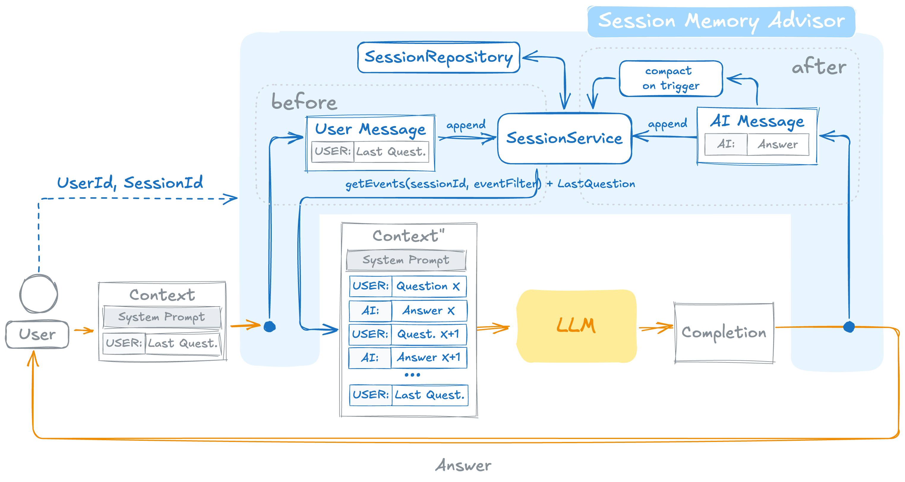

# ChatClient Integration

Two advisors wire a session into a `ChatClient`, so application code never loads or
appends history by hand:

- `SessionMemoryAdvisor` works on each model call: it loads the history into the prompt
  and stores the messages and the token usage.
- `SessionTurnAdvisor` works on each `ChatClient` call: it runs the call as one turn of the
  session (its status) and compacts the session once the turn has ended.

The memory advisor runs inside the tool-calling loop, once per round; the turn advisor
runs outside it, so it sees the turn's final response however the loop ended. The memory
advisor works on its own and then leaves the status alone; tool confirmation and the
`BudgetAdvisor` need the turn advisor.

The advisors live in the `spring-ai-session-chatclient` module, with the `BudgetAdvisor`
and the `RecursiveSummarizationCompactionStrategy`;
the core `spring-ai-session` module has no dependency on `ChatClient`, so an agent runtime
that is not built on `ChatClient` can use the session without the advisors. The JDBC
starter includes the `ChatClient` module.

---

## What the advisors do

On every model call the memory advisor:

1. Resolves the session ID from `SESSION_ID_CONTEXT_KEY`, which **must** be present on
   every request, creating the session if it does not exist and checking ownership if it
   does (see [Passing a session ID per request](#passing-a-session-id-per-request)). A
   session the advisor creates is stamped with the advisor's `agent(AgentSnapshot)` when
   one is configured (see [Agent snapshot](../session-management/concepts.md#agent-snapshot)).
2. Loads the session's history with the configured `eventFilter` (default
   `EventFilter.all()`), merged with any per-request `EVENT_FILTER_CONTEXT_KEY` filter, and
   **prepends** it to the prompt. `EventFilter.active()` is always merged in on top, so
   the prompt only ever sees the active view, never the events a compaction covered. Of any stored system messages
   (an opt-in), only the latest one is kept; under a window it is looked up
   separately, so a window never drops the system prompt. A `lastN` window is extended by
   the repository to the start of the turn it lands in, and any tool call or tool result
   left without its counterpart is dropped from the prompt with a warning (see
   [Tool-call integrity](#tool-call-integrity)).
3. Moves all `SystemMessage`s to the front, in their relative order, and sends a text that
   exactly matches an earlier one only once. Texts are never merged or rewritten, so the
   prompt stays stable for prompt caching. See [System Messages](../session-management/system-messages.md).
4. Appends the prompt's last user message to the session, if the configured
   `MessageFilter` accepts it. Inside a tool-calling loop this is the trailing
   tool-response message instead (`Prompt.getLastUserOrToolResponseMessage()`); it is
   always stored, whatever the filter says.
5. After the model responds, appends the assistant message(s) through the configured
   `MessageFilter` (default: `MessageFilter.skipEmptyMessages()`); a reply with tool calls
   is always stored. By default, empty
   assistant messages (blank text, no tool calls, and no media) are skipped — some
   models (e.g. Bedrock Converse) emit an empty `end_turn` frame after tool use that
   would otherwise be replayed and rejected on the next request.
6. Records the call's token usage as a `USAGE` event, with the model's name, when the
   reply carries usage. `recordUsage(false)` turns it off. See
   [Usage and budget](../session-management/concepts.md#usage-and-budget).

On every `ChatClient` call the turn advisor:

1. Finds the session or creates it, like the memory advisor, stamped with its own
   `agent(AgentSnapshot)`.
2. Starts the turn (`startTurn`), which rejects a second concurrent turn on the same
   session. A request that decides on tool calls resumes the parked turn instead (see
   [Tool confirmation](#tool-confirmation)).
3. Ends the turn once the call returns (`END_TURN`), whether the loop ended with a final
   reply, a `returnDirect` tool or a breached tool-call limit, or parks it when the loop
   paused on tool calls that need a person's confirmation (`REQUIRES_ACTION`). A call
   that fails ends it with `ERROR`, a cancelled stream with `INTERRUPTED`. A turn someone
   else ended (interrupted, out of budget) is left as it is. See
   [Status, turns and archive](../session-management/concepts.md#status-turns-and-archive).
4. If a trigger fires, compacts the session **synchronously** before returning, once per
   turn. The whole turn is written by then, so compaction never races the message
   appends. A failed compaction is logged; the reply is returned and the compaction is
   retried after the next turn.

The diagram below shows the memory advisor's round-trip: the **before** phase loads history and builds the
expanded prompt, the **after** phase appends the assistant message and compacts on trigger.



---

## Setup

`SessionAdvisors` builds the session advisors together, each at its default order around
the tool-calling loop that the `ChatClient` registers itself:

```java
ChatClient client = ChatClient.builder(chatModel)
    .defaultAdvisors(SessionAdvisors.builder(sessionService)
        .toolCallingManager(toolCallingManager)   // the loop's manager; see Tool confirmation
        .compaction(new TurnCountTrigger(20),
            RecursiveSummarizationCompactionStrategy.builder(chatClient).maxEvents(10).build())
        .build())                                 // SessionTurnAdvisor, SessionMemoryAdvisor
    .build();

String answer = client.prompt()
    .user("Hello")
    .advisors(SessionAdvisors.session(sessionId))
    .call()
    .content();
```

- `agent(...)` and `scheduler(...)` apply to both advisors.
- `budgetPolicy(...)` adds a `BudgetAdvisor` (see [Budget](#budget)).
- `memory(b -> ...)` customizes the `SessionMemoryAdvisor`: its filters, event id
  generators and usage recording.
- `build()` returns a `List<Advisor>`.

To place the advisors yourself, build them one by one:

```java
SessionTurnAdvisor turn = SessionTurnAdvisor.builder(sessionService)
    // Compact when 20 turns accumulate, using LLM summarization to retain context
    .compactionTrigger(new TurnCountTrigger(20))
    .compactionStrategy(
        RecursiveSummarizationCompactionStrategy.builder(chatClient)
            .maxEvents(10)
            .build()
    )
    .build();

SessionMemoryAdvisor memory = SessionMemoryAdvisor.builder(sessionService).build();

ChatClient client = ChatClient.builder(chatModel)
    .defaultAdvisors(turn, memory)   // HIGHEST_PRECEDENCE + 200 and + 1000
    .build();
```

!!! warning "Session ID is required on every request"
    `SESSION_ID_CONTEXT_KEY` must be set in the advisor context on every call.
    Omitting it throws `IllegalStateException`. This is intentional — a shared fallback
    session ID would silently merge history across different users.

!!! warning "Trigger and strategy must be set together"
    Setting only one of `compactionTrigger` or `compactionStrategy` makes `build()` throw
    `IllegalArgumentException`. Set both or neither.

!!! note "Default advisor order — the turn outside the loop, the memory inside it"
    The turn advisor's default order is `Ordered.HIGHEST_PRECEDENCE + 200`, so it wraps the
    tool-calling advisor. The memory advisor's is `Ordered.HIGHEST_PRECEDENCE + 1000`, a lower precedence than
    `ToolCallingAdvisor`'s `HIGHEST_PRECEDENCE + 300`. The tool-calling advisor therefore
    wraps `SessionMemoryAdvisor`, whose `before()`/`after()` run once per round of the
    tool-call loop.

    This is deliberate and safe. From round 2 on, the prompt starts with the turn so far,
    which the loaded history ends with, so `before()` prepends only the history before
    that overlap. This holds with or without the tool loop's own history
    (`conversationHistoryEnabled`). Messages
    are compared by content (type, text, tool calls and tool responses), not `equals`, so the
    check also works when the repository doesn't store message metadata, as with JDBC. System
    messages are left out of this check, because they are always moved to the front; the
    exact-text duplicate of a stored one is dropped. Only each round's trailing
    user/tool-response message and the model's reply are persisted, so nothing is stored
    twice either. You don't need `.disableInternalConversationHistory()` on the
    tool-calling advisor.

    Set `.order(n)` below the tool-calling advisor's order if `SessionMemoryAdvisor` should
    instead wrap the loop and write to the session once, after tool results are resolved.

---

## Idempotent session-event ids {#idempotent-session-event-ids}

A durability layer may replay a `ChatClient` call after a crash or a timeout. The memory
advisor then writes the same messages again. To make such a replay write nothing twice,
give each call a **run id**, the call's idempotency key: a retry of the call uses the same
run id, a new call a new one.

```java
chatClient.prompt()
    .user("Book VX205")
    .advisors(SessionAdvisors.session(sessionId, runId))   // RUN_ID_CONTEXT_KEY
    .call()
    .content();
```

The default id generator, `RunScopedSessionEventIdGenerator`, then derives each event's id
from its position in the run, never from what the message says:

- the session id;
- the run id, from `SessionTurnAdvisor.RUN_ID_CONTEXT_KEY`;
- how the turn began: a new call, or the resumption of a parked turn;
- the round of the tool-calling loop, which the `SessionTurnAdvisor` counts;
- the slot in the round: the request's message, or the reply of a generation. The usage
  event and the answers to interrupted tool calls take their ids from the reply's.

A replay of the run gets the same ids, and `appendEvent` with an existing id is a no-op
(see [Idempotent `appendEvent`](../session-management/concepts.md#idempotent-appendevent)).
Two messages with the same text never share an id: "yes" in two calls is two events, and
so are two identical tool calls in one turn, with or without tool call ids. The ids have
the form `<messageType>-<sha256>`, at most 74 characters. The turn also records the run id
(`SessionService.startTurn(sessionId, runId)`); the call that resumes a parked turn may
keep the run id of the call it resumes.

- **Without a run id**, or without the `SessionTurnAdvisor`, the ids are random, so a
  retried write is a new event. Nothing is mistaken for a replay.
- **A replayed round whose model gives a different reply** gets the same id as the first;
  the log keeps the first reply.

To write your own generator, implement `SessionEventRequestIdGenerator` and/or
`SessionEventResponseIdGenerator`, and set it with `requestEventIdGenerator(...)` and
`responseEventIdGenerator(...)` on the `SessionMemoryAdvisor` builder (or through
`SessionAdvisors.builder(...).memory(...)`). `SessionEventRequestIdGenerator.random()` and
`SessionEventResponseIdGenerator.random()` always give random ids.

`IdempotentSessionEventIdGenerator`, which derives ids from the message's content, is
deprecated: two identical messages in a session get the same id, so the second is dropped
as a replay.

---

## Passing a session ID per request

Pass a session ID at call time via the advisor context:

```java
String response = client.prompt()
    .user("Hello!")
    .advisors(a -> a.param(SessionMemoryAdvisor.SESSION_ID_CONTEXT_KEY, "session-abc"))
    .call()
    .content();
```

If no session exists for the given ID, the advisor creates one through
`SessionService.create`. The session's scope, the principal name under
`SessionAttributes.PRINCIPAL_NAME`, normally comes from the service's
`SessionScopeResolver`. Creation metadata passed with `SESSION_METADATA_CONTEXT_KEY` is
applied as the request's own metadata, so an attribute set there wins over the resolver,
and an authorizing service decides whether the caller may set it:

```java
client.prompt()
    .user("Hello!")
    .advisors(a -> a
        .param(SessionMemoryAdvisor.SESSION_ID_CONTEXT_KEY, "session-abc")
        .param(SessionMemoryAdvisor.SESSION_METADATA_CONTEXT_KEY, Map.of("agent", "support"))
    )
    .call()
    .content();
```

!!! note "Who may use a session"
    The advisor does not decide that. Every read and append goes through the
    `SessionService`, and with the security module an `AuthorizingSessionService` checks
    each call against the caller: a session is denied to anyone but its principal. See
    [Scope and Security](../session-management/scope-and-security.md).

---

## Context keys

| Key constant | String value | Purpose |
|---|---|---|
| `SESSION_ID_CONTEXT_KEY` | `"chat_memory_conversation_id"` (= `ChatMemory.CONVERSATION_ID`) | Routes the request to a session |
| `SESSION_METADATA_CONTEXT_KEY` | `"chat_memory_session_metadata"` | A `Map<String, Object>` of metadata for a session the advisor creates on first use; ignored for an existing session |
| `EVENT_FILTER_CONTEXT_KEY` | `"chat_memory_event_filter_id"` | Per-request `EventFilter` merged with the advisor-level filter |
| `REQUEST_EVENT_ID_CONTEXT_KEY` | `"chat_memory_request_event_id"` | Set by the advisor: the id of the event that stores the request's trailing user or tool message; absent when none was stored. Read it from the forwarded request or from `call().chatClientResponse().context()` |
| `RESPONSE_EVENT_IDS_CONTEXT_KEY` | `"chat_memory_response_event_ids"` | Set by the advisor on the response: the ids of the events that store the reply's assistant messages, a `List<String>`, empty when none was stored. Streamed chunks do not carry it; `subscribe(sessionId)` delivers the stored events instead |
| `SessionTurnAdvisor.TOOL_CALL_DECISIONS_CONTEXT_KEY` | `"tool_call_decisions"` | A `ToolCallDecisions`, a `ToolCallDecision` or a collection of them, for the tool calls the parked turn waits on; see [Tool confirmation](#tool-confirmation) |

---

## Per-request filter override

Pass an `EventFilter` via `EVENT_FILTER_CONTEXT_KEY` to narrow or adjust history
retrieval on a single call without reconfiguring the advisor:

```java
// Advisor is configured with EventFilter.all() (default).
// This request overrides to see only the last 5 events, extended to the start of
// the turn the window lands in so a tool call is never sent without its result.
String response = client.prompt()
    .user("Quick summary please")
    .advisors(a -> a
        .param(SessionMemoryAdvisor.SESSION_ID_CONTEXT_KEY, sessionId)
        .param(SessionMemoryAdvisor.EVENT_FILTER_CONTEXT_KEY, EventFilter.lastN(5))
    )
    .call()
    .content();
```

`EventFilter.merge()` semantics: every non-null field from the request filter replaces
the corresponding field from the advisor default; the two boolean flags, `excludeSynthetic`
and `activeView`, are OR-ed so either side can opt in. A request-level window (`lastN`, a
page or a cursor) replaces the advisor's window as a whole (see
[Merging filters](../session-management/event-filtering.md#merging-filters)). A `null` value for
`EVENT_FILTER_CONTEXT_KEY` is ignored.

---

## Filtering what gets persisted (`MessageFilter`)

While `EventFilter` controls which **stored** events are loaded into the next prompt,
`MessageFilter` controls which messages get **stored at all**. A message rejected by the
filter is never persisted and therefore never replayed on later requests. The outgoing
prompt is unaffected — filtering applies to persistence only.

| | `EventFilter` (read side) | `MessageFilter` (write side) |
|---|---|---|
| Applies when | Loading history in `before()` | Appending messages in `before()` / `after()` |
| Operates on | Stored `SessionEvent`s | `Message`s about to be persisted |
| Rejected items | Stay in storage, hidden from the prompt | Never written to storage |
| Tool messages | A tool call or result left without its counterpart is dropped from the prompt | Always stored, whatever the filter says |

Configure it on the builder:

```java
SessionMemoryAdvisor advisor = SessionMemoryAdvisor.builder(sessionService)
    // Never persist messages containing "confidential", still skipping empty frames
    .messageFilter(
        MessageFilter.containsText("confidential").negate()
            .and(MessageFilter.skipEmptyMessages())
    )
    .build();
```

Tool calls and tool results are always stored, whatever the filter says: either half
alone makes a prompt every provider rejects, and parking, resuming and interrupting a turn
read them back from the log. To keep verbose tool traffic out of the **prompt**, hide it
on read instead; the read guard drops the calls left without their results:

```java
SessionMemoryAdvisor.builder(sessionService)
    .eventFilter(EventFilter.builder().messageTypes(Set.of(MessageType.USER, MessageType.ASSISTANT)).build())
    .build();
```

Built-in factories:

| Factory | Behavior |
|---|---|
| `MessageFilter.all()` | Persists every message (no filtering) |
| `MessageFilter.skipEmptyMessages()` | Skips assistant messages with blank/null text, no tool calls, and no media (**the default**) |
| `MessageFilter.byMessageType(types...)` | Persists only the listed `MessageType`s; tool calls and tool results are stored anyway |
| `MessageFilter.containsText(keyword)` | Persists only messages whose text contains the keyword (case-insensitive) |

`MessageFilter` is a `@FunctionalInterface`, so a lambda works too, and filters compose
via `and()`, `or()`, and `negate()`:

```java
// Persist only user messages and assistant text
.messageFilter(
    MessageFilter.byMessageType(MessageType.USER, MessageType.ASSISTANT)
        .and(MessageFilter.skipEmptyMessages())
)
```

!!! warning "Compose, don't replace"
    Setting a custom `messageFilter` **replaces** the default
    `skipEmptyMessages()` protection. If you still want empty assistant frames
    filtered out (recommended — some models reject them when replayed as history),
    compose your filter with it via `.and(MessageFilter.skipEmptyMessages())`.

---

## Tool confirmation

Some tools should not run until a person has seen the call. Spring AI's tool calling
decides which ones: a tool marked `@Tool(requiresConfirmation = true)`, or a
`ToolCallConfirmationPolicy` on the `ToolCallingManager`. The tool-calling loop then
pauses: none of the reply's calls run, and the reply comes back with the ids of the calls
that wait for a decision (`ToolCallDecisions.awaitingDecision(response)`). The session
makes the pause durable. The `SessionTurnAdvisor` parks the turn on it and resumes it when
the decisions arrive, on any node.

Give the turn advisor the loop's own manager, so the policy and the tool call limits are
the same on both sides of the pause:

```java
// In Spring Boot, inject the ToolCallingManager bean: the ChatClient's own loop uses it
ChatClient chatClient = ChatClient.builder(chatModel)
    .defaultAdvisors(SessionAdvisors.builder(sessionService)
        .toolCallingManager(toolCallingManager)
        .build())
    .defaultTools(new BookingTools()) // bookFlight is @Tool(requiresConfirmation = true)
    .build();
```

Without Spring Boot, or with a loop of your own, give the loop the same manager:
`ToolCallingAdvisor.builder().toolCallingManager(toolCallingManager).build()`. Both
default to `ToolCallingManager.builder().build()`, which gates the tools marked
`requiresConfirmation`; pass one manager to both when you customize it.

A reply that asks for `bookFlight` comes back to the application with the tool call in
it, and the session is idle with `stopReason() == StopReason.REQUIRES_ACTION`. Show the
call, then send the decisions on the next request. The request carries no new user text
(new text goes in the next turn), and it must carry the tools, because the allowed calls
run with them:

```java
List<String> waiting = ToolCallDecisions.awaitingDecision(reply);

String answer = chatClient.prompt()
    .advisors(SessionAdvisors.decide(sessionId, ToolCallDecision.allow(waiting.get(0))))
    .call()
    .content();
```

`SessionAdvisors.decide` sets the session id and `SessionTurnAdvisor.TOOL_CALL_DECISIONS_CONTEXT_KEY`.

When streaming, the ids are on the last chunk of the reply.

- `ToolCallDecision.deny(toolCallId, "Not on production.")` answers the call with that
  text instead of running it.
- Every call that waits needs a decision. A call of the same reply that does not wait is
  allowed.
- The calls that run come from the session's log, never from the request.
- A decision for a call that is not waiting, a session that is not waiting, new user text
  next to the decisions, or an allowed call whose tool the request does not carry is an
  `IllegalArgumentException`, raised before anything is recorded.
- Resuming starts the turn with the same compare-and-set as any call, so a second request
  with the same decisions fails instead of running the tool twice.
- The tool results are stored like any other. A `returnDirect` tool's results are stored
  and returned without calling the model.
- A resumption that fails ends the turn with `ERROR`. If no call ran, the calls are still
  open in the log and can be decided on again; once a call ran, they are answered with the
  failure, so none runs twice.
- The tool-calling loop counts its tool call limits from the resumption on, so a pause
  restarts them once.
- A `returnDirect` result is stored by the turn advisor with a random event id, not with
  the memory advisor's id generators.
- A turn interrupted while the model asked for a gated call does not park: the call is
  answered as interrupted (see [Interrupting a running call](#interrupting-a-running-call)).
- A decision names a call by its key, as `ToolCallDecisions.awaitingDecision(reply)` lists
  them: the call's id, or `#<position>` for a model that gives its tool calls no ids.

The parked turn is an
[interaction](../session-management/concepts.md#interactions-a-parked-turn-in-general): an
`INTERACTION` question of kind `toolConfirmation` with the paused calls and the ids that
wait, named by the status event next to the reply, and an `INTERACTION` answer with the
decisions. `ToolConfirmations` reads and writes both.

Tools that the Tool Search Tool adds per round are not on the request that resumes, so an
allowed call to one cannot run; deny it, or put the tool on the request.

---

## Interrupting a running call

`SessionService.interrupt(sessionId, reason)` ends the running turn with `INTERRUPTED`, from
any thread or any process that shares the log. A `ChatClient` call that runs the turn stops
at its next step: the `SessionMemoryAdvisor` checks on every round of the tool loop, and
throws a `TurnInterruptedException`.

- **Before a model call:** no further model call is made. The results of the tools that ran
  are stored first.
- **After a reply that asks for tools:** the tools do not run. The reply's tool calls are
  answered in the log with `SessionMemoryAdvisor.INTERRUPTED_TOOL_RESULT`, so the log stays
  valid and the next turn's model learns why.
- A tool that is running when the interrupt comes finishes; the loop stops after it.
- A streamed call ends with the exception as its error.

The check needs the `SessionTurnAdvisor`, which marks the requests of the turn it runs; the
memory advisor on its own never stops a call. A turn interrupted and then started again by
another request before the loop's next step is not told apart from the running one.

```java
try {
    chatClient.prompt().user("Plan my trip").advisors(SessionAdvisors.session(sessionId)).call().content();
}
catch (TurnInterruptedException ex) {
    // stopped from elsewhere; the session is idle with stopReason INTERRUPTED
}
```

---

## Budget

`BudgetAdvisor` refuses a model call once the session tree's usage has reached its budget.
It reads the `USAGE` events the memory advisor records, so it sits inside the memory
advisor (default order `HIGHEST_PRECEDENCE + 1100`), where the turn is running and every
round of a tool loop passes through it:

```java
ChatClient chatClient = ChatClient.builder(chatModel)
    .defaultAdvisors(
        SessionMemoryAdvisor.builder(sessionService).build(),
        BudgetAdvisor.builder(sessionService)
            .policy(BudgetPolicy.fixed(Budget.ofTotalTokens(200_000)))
            .build())
    .build();
```

The refused call throws `BudgetReachedException`, which carries the session id, the tree's
usage and the budget; in a stream it arrives as the error signal. The session is then idle
with `stopReason() == StopReason.BUDGET_REACHED`, and every call on the tree is refused the
same way until the policy returns a higher budget, for example
`BudgetPolicy.fromMetadata("budget")` after the root's metadata was raised. A child's usage
counts towards its root's budget, and a call on a child is refused like one on the root.
The budget is checked before a call, not after it, so the call that crosses it completes.

---

## Tool-call integrity

Every provider rejects a prompt in which an assistant message with tool calls is not
followed by the tool messages answering it (OpenAI: *"An assistant message with
'tool_calls' must be followed by tool messages responding to each 'tool_call_id'"*). The
advisor keeps that from happening at both ends, without touching the log:

- **Windows keep turns whole.** A `lastN` window is extended by the repository to the
  start of the turn it lands in, so a tool call is never read without its results. See
  [Windows keep turns whole](../session-management/event-filtering.md#windows-keep-turns-whole).
- **Read guard.** After loading the history, an assistant tool call whose calls are not
  all answered by the tool messages that directly follow it (in the history or in the
  prompt itself, as in round 2 of a tool loop) is dropped from the prompt, and so is a tool
  message that answers no preceding call. A partially answered parallel call is dropped
  with its answers. The advisor logs a `WARN` naming the likely causes: a `messageTypes`
  read filter hiding `TOOL` events, a log an earlier version wrote with a `MessageFilter`
  that skipped them, or a turn interrupted between the call and its result.
- **Write side.** Tool calls and tool results are always stored, whatever the
  `MessageFilter` says, so the log never holds one half without the other. A replay of a
  call without a run id writes its tool results again after the first attempt's answer;
  the read guard drops those from the prompt. With a run id the replay writes nothing
  (see [Idempotent session-event ids](#idempotent-session-event-ids)).
---

## Concurrent compaction safety

Concurrent `after()` calls on the same session (e.g. parallel fan-out) may both compact;
the [optimistic compare-and-swap](../session-management/concepts.md#optimistic-concurrency) makes the loser skip
silently, so no compacted result is lost or corrupted.

---

## Scheduler pinning

Both the blocking (`advise()`) and streaming (`adviseStream()`) paths run `before()` and
`after()` on the configured `Scheduler` (default: `BaseAdvisor.DEFAULT_SCHEDULER`). In
`adviseStream()`, a second `.publishOn(scheduler)` is applied after
`.flatMapMany(chain::nextStream)` so that the aggregation callback and compaction always
run on the scheduler rather than the LLM streaming thread.
