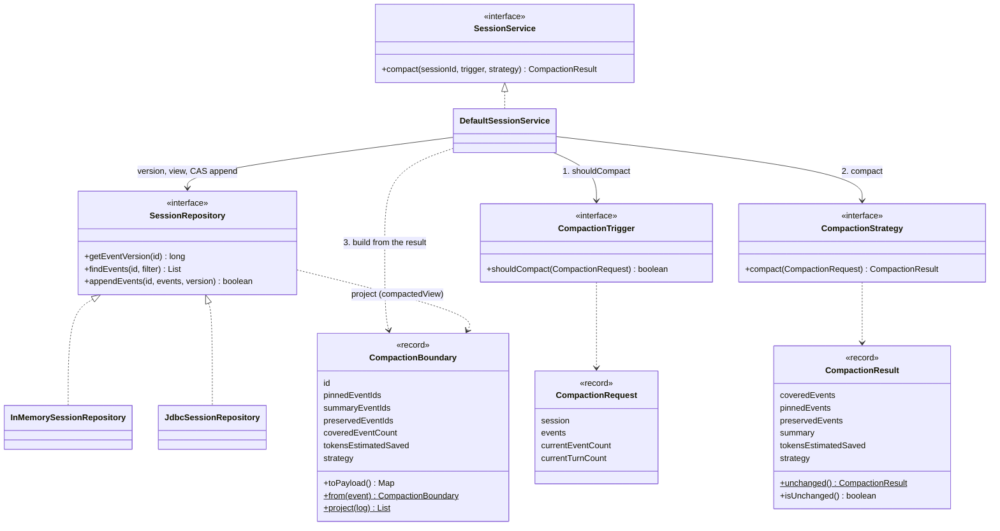
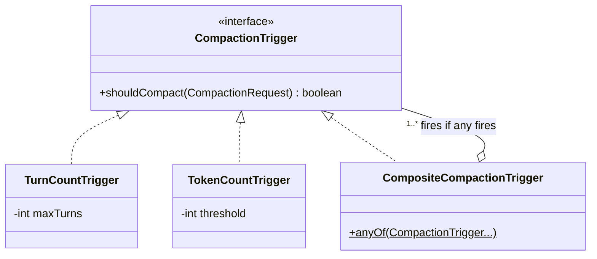
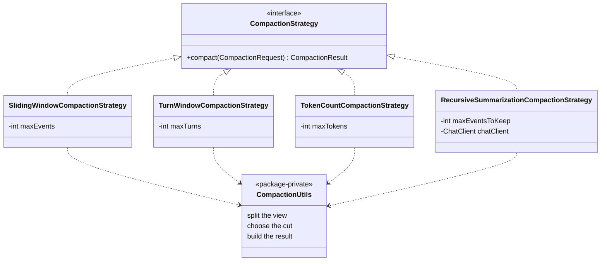
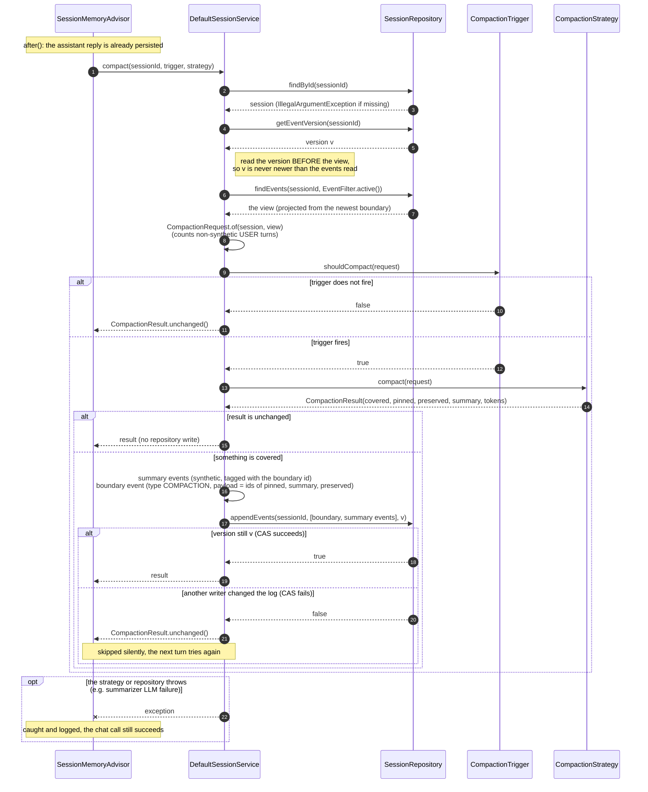
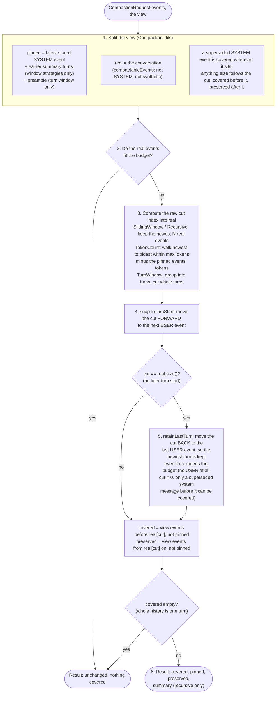
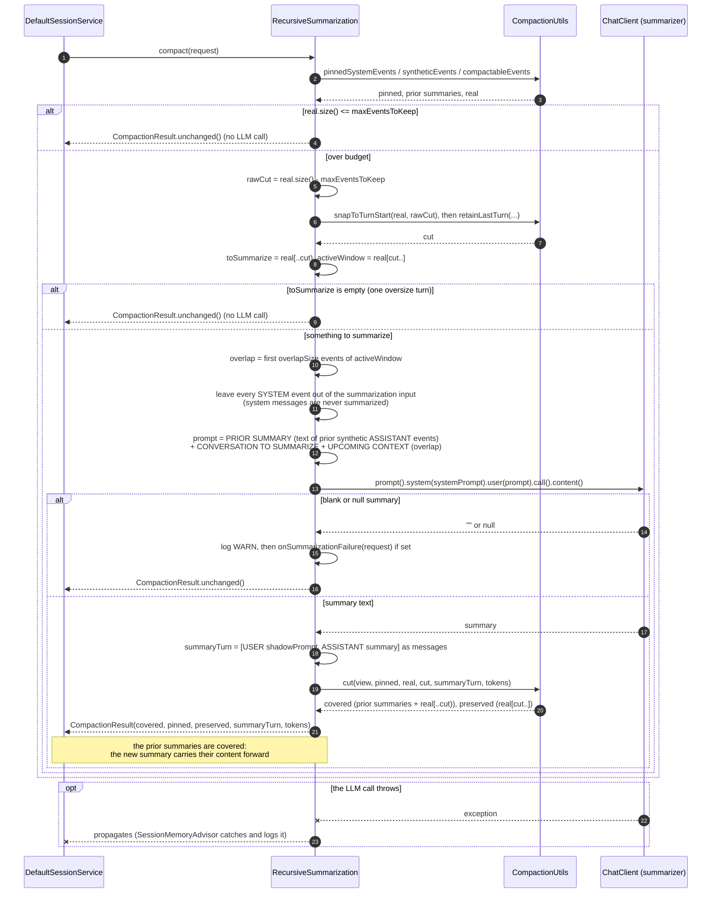
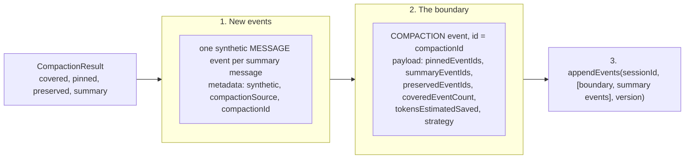
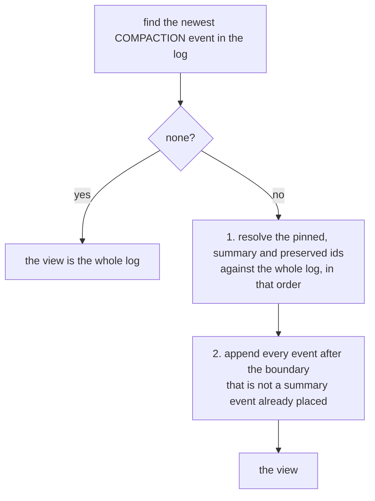
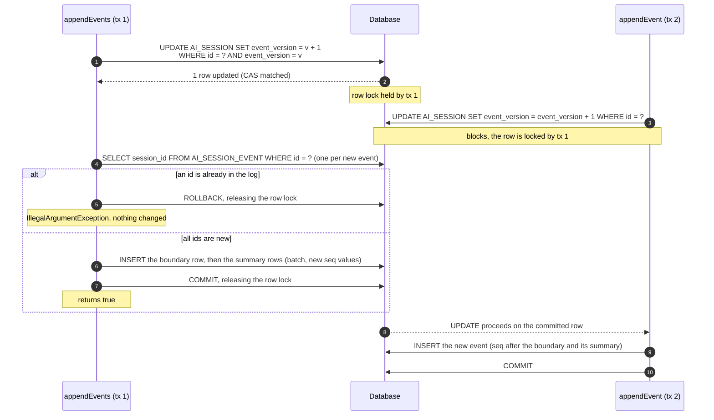

# How Compaction Works

This page explains what happens when a compaction pass runs, with diagrams and worked
examples. For choosing and configuring triggers and strategies, see
[Context Compaction](compaction.md).

| Section | Answers |
|---|---|
| [1. Class diagrams](#1-class-diagrams) | Which types take part, and what each contributes |
| [2. A compaction pass](#2-sequence-a-compaction-pass-end-to-end) | What the service, the strategy and the repository do, in order, and how the version check keeps concurrent writers apart |
| [3. What gets covered](#3-activity-how-a-strategy-chooses-what-to-cover) | How a strategy turns its budget into a cut that never splits a turn |
| [4. Summarization](#4-sequence-recursivesummarizationcompactionstrategy) | What the LLM is given, where the summary lands, what happens on a blank answer |
| [5. The boundary](#5-the-boundary-from-result-to-write) | How a strategy result becomes one appended boundary event, and how the active view is projected from it |
| [6. JDBC and a concurrent append](#6-sequence-jdbc-appendevents-and-a-concurrent-append) | How the row lock orders a compaction against an append, and how the view is read |
| [7. Tricky cases](#7-worked-examples-of-the-tricky-cases) | Seven inputs and their outputs: mid-turn cuts, oversize turns, updated system prompts, a prior summary |

Two words are used precisely throughout. The **log** is the session's event list: it is
append-only, and compaction never updates, moves or removes an event in it. The **view**
is the active context window: the part of the log the newest compaction boundary names,
plus everything appended since. An event is **covered** when a compaction leaves it out of
the view; it stays in the log, searchable through Recall Storage. Only deleting or
expiring the whole session removes events.

!!! note "Implementation details"
    This page describes the current implementation. Package-private helpers such as
    `CompactionUtils` and the exact SQL used by `JdbcSessionRepository` are not public API
    and may change between releases. The public contract is `CompactionTrigger`,
    `CompactionStrategy`, `CompactionRequest`, `CompactionResult`, `CompactionBoundary`,
    `SessionService.compact(...)` and `SessionRepository.appendEvents(...)`.

---

## 1. Class diagrams

### 1a. Core contract

The **trigger** decides *whether* to compact, the **strategy** decides *what* leaves the
view, and the **repository** records the decision atomically. `DefaultSessionService.compact(...)`
connects them. Any caller can invoke it: `SessionMemoryAdvisor`, or your own code.



- **Triggers are cheap; strategies can be expensive.** The service always runs the trigger
  first, and only calls the strategy when it fires. That matters most for
  `RecursiveSummarizationCompactionStrategy`, which calls an LLM.
- **Strategies are pure.** They take a `CompactionRequest` (the session plus its *view*)
  and return a `CompactionResult`. They never touch the repository; the service records
  the result.
- **`CompactionResult` partitions the view.** `coveredEvents` leave the view;
  `pinnedEvents` stay at its front (the latest stored system message, and for the window
  strategies the earlier summary turns); `preservedEvents` are the recent events kept
  verbatim; `summary` is the new summary turn, as messages, that stands in for the covered
  events (empty for the window strategies). `unchanged()` means nothing leaves the view.
- **The service turns the result into one `CompactionBoundary` event.** The repository
  appends it without interpreting the result, and from then on reads the view through it.
  §5 explains how the boundary is built and how the view is projected.

### 1b. Triggers



| Trigger | Fires when | Settings |
|---|---|---|
| `TurnCountTrigger` | more than `maxTurns` turns (non-synthetic `USER` events) | `maxTurns` (constructor) |
| `TokenCountTrigger` | estimated tokens `>=` `threshold`, counted like the strategy's [budget](compaction.md#how-the-budget-is-spent) | `threshold` (required), `tokenCountEstimator` (default JTokkit) |
| `CompositeCompactionTrigger` | any of its triggers fires | `anyOf(...)` |

### 1c. Strategies



| Strategy | Keeps | Settings (defaults) |
|---|---|---|
| `SlidingWindowCompactionStrategy` | the newest `maxEvents` real events, cut at a turn boundary | `maxEvents` (20), `tokenCountEstimator` (JTokkit) |
| `TurnWindowCompactionStrategy` | the newest `maxTurns` complete turns | `maxTurns` (10), `tokenCountEstimator` (JTokkit) |
| `TokenCountCompactionStrategy` | a contiguous suffix of real events within `maxTokens`, cut at a turn boundary | `maxTokens` (4000), `tokenCountEstimator` (JTokkit) |
| `RecursiveSummarizationCompactionStrategy` | the newest `maxEventsToKeep` real events, plus an LLM summary of the rest | `chatClient` (required), `maxEventsToKeep` (10), `overlapSize` (2), `systemPrompt`, `shadowPrompt` (`DEFAULT_SUMMARY_SHADOW_PROMPT`), `eventFormatter`, `onSummarizationFailure`, `tokenCountEstimator` (JTokkit) |

All four share the helpers in `CompactionUtils`:

- **Split the view:** `pinnedSystemEvents` (the latest stored system message),
  `syntheticEvents` (earlier summary turns) and `compactableEvents` (the real
  conversation).
- **Choose the cut:** `snapToTurnStart` and `retainLastTurn`. `TurnWindowCompactionStrategy`
  only uses `isTurnStart`: it groups events into whole turns, so it needs no snapping.
- **Build the result:** `cut`, which partitions the view into covered, pinned and
  preserved events around the chosen cut and attaches the summary.

How these fit together is shown in [section 3](#3-activity-how-a-strategy-chooses-what-to-cover).

---

## 2. Sequence: a compaction pass, end to end

This covers what happens after a turn when compaction is configured on the advisor,
including the two "nothing happens" paths and the lost-race path.



**Why the version is read first.** If an append lands between `getEventVersion` and
`findEvents`, the strategy sees the new event but the CAS still expects the older
version, so the write is rejected. The service never records a result computed from
events that are newer than the version it checks.

**Why the boundary comes first in the append.** The boundary names the summary events by
id, and the view is "what the boundary names, then everything after the boundary". The
summary events are appended right after it, so they are both named and after it; the
projection places them once, in the summary slot (§5b).

---

## 3. Activity: how a strategy chooses what to cover

All four strategies share this pipeline; its output is the `CompactionResult` that the
service records as a boundary (see §2). They differ in step 3, how the raw cut is
computed, and in two more places:

- `TokenCountCompactionStrategy` has no step 2 shortcut: it always walks the events and
  computes a cut.
- `TurnWindowCompactionStrategy` cuts whole turns, so it skips steps 4 and 5. Events
  before its first `USER` event form a preamble that is pinned.



**Invariants the pipeline guarantees:**

- **The preserved events always start at a `USER` event,** apart from
  `TurnWindowCompactionStrategy`'s preamble, which is pinned. No kept assistant reply or
  tool result loses the user message that started its turn.
- **The newest turn is never covered.** Step 5 keeps it even when it alone exceeds the
  budget.
- **At most one stored system message is pinned,** the latest, and it is never
  summarized. Earlier ones are covered when they sit before the cut and preserved, where
  they are, when they sit after it; a pass that needs no cut leaves the view unchanged.
- **Earlier summary turns survive** the sliding-window, turn-window and token-count
  strategies, pinned. The recursive strategy covers them and carries their content
  forward in the new summary (see section 4).

---

## 4. Sequence: RecursiveSummarizationCompactionStrategy

The most complicated strategy: it calls an LLM, folds earlier summaries into the new one,
and has to keep system messages out of the summary.



**What makes it "recursive".** Each pass feeds the previous summary's text back to the
LLM as `=== PRIOR SUMMARY ===`. The new summary therefore builds on the old one, and the
old summary turn is covered like the events it summarized. The resulting view holds the
latest stored system message (if any) first, then one summary turn, then the recent real
events.

**Why the summary is a user + assistant pair.** Many providers require the messages after
the system prompt to alternate user and assistant. The shadow-prompt user message plus
the assistant summary, followed by preserved events that start with a user message, keep
that alternation valid; a lone assistant summary would not.

**The strategy returns messages, not events.** The summary turn becomes events only when
the service records it (§5a), so the strategy never has to know the session's ids or
timestamps and the summary events are created in the same append as the boundary.

---

## 5. The boundary: from result to write

A strategy answers one question: what should the view look like now? A repository needs
a different one: what do I write? The answer is always the same shape, whatever the
strategy: one `COMPACTION` event whose payload is a `CompactionBoundary`, followed by the
summary events. Nothing that is already in the log is touched. Compaction is a
**projection**: the boundary is a record in the log, and the view is computed from the
newest one on every read.

### 5a. Recording the result: `DefaultSessionService.compact`



- **The view is named by id, not by position.** A boundary lists the ids of the pinned,
  summary and preserved events, in view order. Ids survive anything a store might do with
  row order, and a chain of compactions stays safe: a pinned system message that was
  stored before the first boundary is named again by every later one.
- **What is not named is covered.** The covered events are not listed; `coveredEventCount`
  and `tokensEstimatedSaved` are kept for reporting. Everything in the log that the newest
  boundary does not name and that precedes it is out of the view.
- **New events must belong to the session.** `appendEvents` rejects an event of another
  session, or one whose id is already in the log, with `IllegalArgumentException` before
  anything is written.

### 5b. Projecting the view: `CompactionBoundary.project(log)`

The reference implementation. `EventFilter.apply(List)` calls it whenever the filter has
`compactedView`, so `InMemorySessionRepository` gets it for free; `JdbcSessionRepository`
fetches only the rows the view can contain and hands them to the same code (§6).



The boundary event itself is never in the view, and neither is any older boundary: an
older boundary precedes the newest one and is not named by it. A view holds `MESSAGE`
events and whatever runtime events were appended since the boundary; `EventFilter.active()`
then keeps the messages.

### 5c. Worked example

A recursive pass with `maxEventsToKeep = 2` on a log that already holds a summary
(`Σold`) from an earlier pass (`⊥1`), in front of the turns that were appended after it.

```
log before      U1 A1 ⊥1 Σold U2 A2 U3 A3
view before     Σold U2 A2 U3 A3                 (⊥1 names Σold as summary; U2 A2 U3 A3 follow it)

result          covered   = [Σold U2 A2]
                pinned    = []
                preserved = [U3 A3]
                summary   = [Σnew]

appended        ⊥2 {pinned: [], summary: [Σnew], preserved: [U3, A3]}   Σnew

log after       U1 A1 ⊥1 Σold U2 A2 U3 A3 ⊥2 Σnew
view after      Σnew U3 A3
```

Every existing event keeps its position and its content. `Σold` stays in the log, so it
still shows what the model was told before this pass and Recall Storage can still find it.
The new summary is placed in front of `U3` by the projection, not by the write: the write
is a plain append, which is what keeps it cheap and keeps the log a faithful record.

---

## 6. Sequence: JDBC `appendEvents` and a concurrent append

On JDBC the CAS is a row-level lock on the session row. Both writers take that lock
*before* touching events. An append must also lock the row before it inserts; otherwise
its event could get a `seq` after a boundary that does not name it, and enter the view as
if it had been appended after the compaction.



**The two orderings:**

- **Compaction locks first** (as drawn): the append waits, then inserts with a higher
  `seq`, so it is ordered after the boundary and enters the view as appended since. It
  also bumps the version again, and the next compaction sees the new event.
- **Append locks first:** compaction's CAS `UPDATE` waits. When the append commits, the
  version is `v + 1`, the CAS matches 0 rows, and `appendEvents` returns `false`. The
  service skips silently, and the next turn compacts from a fresh view.

**Reading the view.** A `findEvents` with `compactedView` runs two queries: the session's
newest `COMPACTION` row (`ORDER BY seq DESC LIMIT 1`), then the rows whose `id` is in the
boundary's pinned, summary or preserved lists `OR` whose `seq` is at or after the
boundary's, ordered by `seq`. `EventFilter.apply` projects, filters and windows that list
in memory; the view is bounded by compaction, so reading it whole is the point. A session
without a boundary is read whole, minus rows a 0.10 compaction flagged `archived`, which
keeps pre-0.11.0 sessions consistent until their first boundary.

**In-memory equivalent:** `InMemorySessionRepository` does the append inside a single
`ConcurrentHashMap.compute`: it checks the version, validates the ids, appends and bumps
the version. Reads go through `EventFilter.apply`, which projects (§5b).

---

## 7. Worked examples of the tricky cases

Each example gives the view before compaction and the resulting view and covered events.
`S:` is a stored system message, `U`/`A` are user and assistant messages, and `Σ` is the
synthetic summary turn.

| # | Case | View before | Strategy | View after | Covered |
|---|---|---|---|---|---|
| 1 | Cut lands mid-turn | `U1 A1 U2 A2a A2b U3 A3` | SlidingWindow, `maxEvents = 3` | `U3 A3` | `U1 A1 U2 A2a A2b` |
| 2 | Newest turn alone is over budget | `U1 A1 U2 A2 A3 A4` | SlidingWindow, `maxEvents = 2` | `U2 A2 A3 A4` | `U1 A1` |
| 3 | Whole history is one oversize turn | `U1 A1 A2 A3` | SlidingWindow, `maxEvents = 2` | unchanged | nothing |
| 4 | System message updated mid-session | `S:v1 U1 A1 S:v2 U2 A2` | SlidingWindow, `maxEvents = 20` | unchanged | nothing |
| 5 | System prompt stored in an old turn | `U1 S A1 U2 A2 U3 A3` | SlidingWindow, `maxEvents = 2` | `S U3 A3` | `U1 A1 U2 A2` |
| 6 | Token budget with a system prompt | `S:sys(11) U(8) A(13) U(8) A(13)` | TokenCount, `maxTokens = 45` | `S:sys U A` (newest turn) | the older turn |
| 7 | Recursive with a prior summary | `Σold U1 A1 U2 A2 U3 A3` | Recursive, `maxEventsToKeep = 2`, `overlapSize = 1` | `Σnew U3 A3` | `Σold U1 A1 U2 A2` |

**Notes on the examples:**

1. The raw cut lands inside turn 2. The forward snap moves it to `U3`, so turn 2 is
   covered whole instead of being split.
2. The raw cut lands inside the last turn, and snapping forward finds no later turn.
   `retainLastTurn` keeps turn 2 even though it exceeds `maxEvents`.
3. Snapping and retaining leave nothing to cover, so the pass is a no-op.
4. The budget needs no cut, so nothing is written. `S:v1` stays in the view until a cut
   covers it; the advisor uses only the latest stored system message, `S:v2`, anyway.
5. The system prompt was stored in turn 1. Turn 1 is covered, but the latest stored
   system message is pinned, first in the view, so later turns still have it.
6. The system prompt's 11 tokens come off the budget first, leaving 34. Only the newest
   turn fits, so the older turn is covered. Without the system prompt both turns (42)
   would fit in 45.
7. The LLM receives `Σold`'s text as the prior summary plus `U1 A1 U2 A2` (and the overlap
   `U3`). `Σold` is covered like the turns it summarized; its content lives on in `Σnew`.
   §5c shows the same case as a log.

---

## See also

- [Context Compaction](compaction.md): triggers, strategies and how to configure them
- [System Messages](system-messages.md): why stored system messages are treated as
  configuration, and the "latest wins" rule
- [Session JDBC](../session-jdbc/index.md): the JDBC repository, schema and design notes
- [Multi-Agent](multi-agent.md): a session per sub-agent
