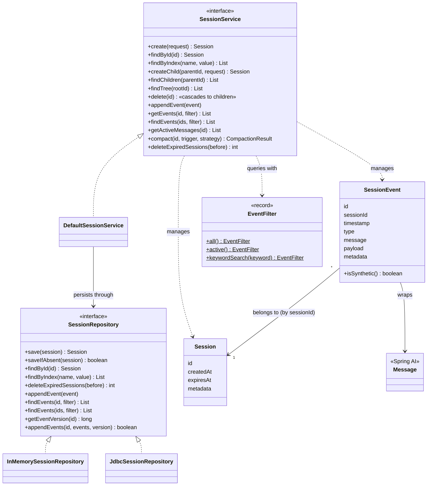
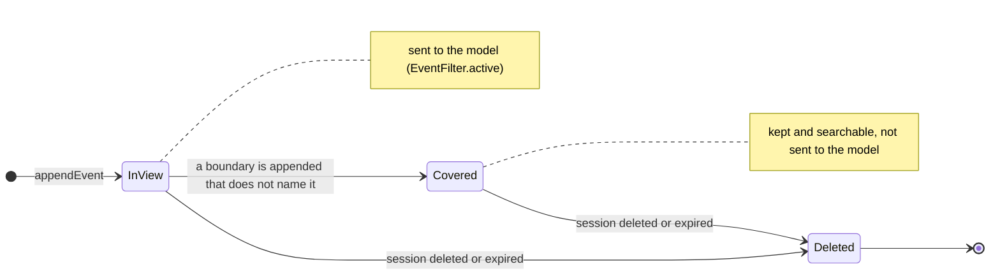
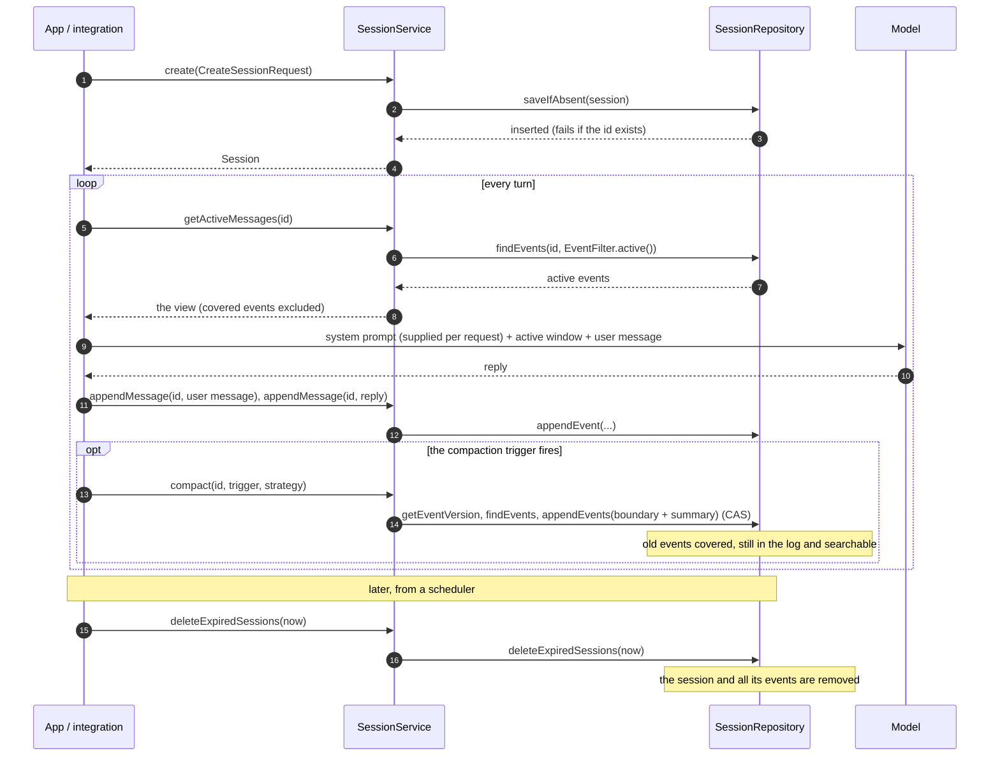
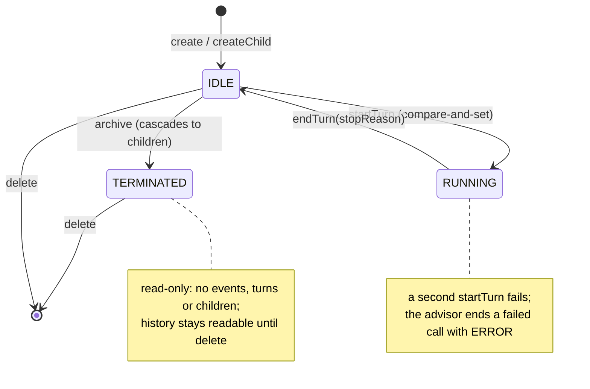
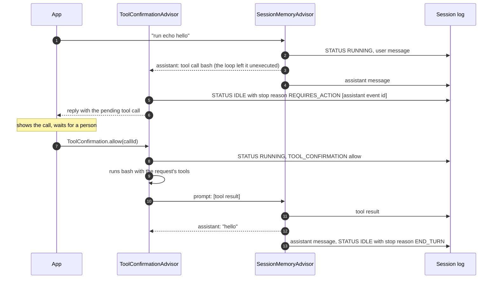

# Session Concepts

Spring AI Session introduces four closely related concepts that together describe how a
conversation is stored, structured, and managed over time.

---

## Session

`Session` is the **identity and lifecycle container** for a single, continuous conversation
between a user and an agent. It is an immutable value object — it holds only metadata.
The event log is stored separately in the repository and fetched on demand.

| Field | Description |
|-------|-------------|
| `id` | Unique session identifier |
| `createdAt` | Creation timestamp |
| `expiresAt` | Expiry instant. Sessions created through `SessionService.create` always get one: the request's `timeToLive`, or the service's default (60 days, configurable); a child takes its parent's. `null` (no expiry) is only possible for a `Session` built directly with `Session.builder().expiresAt(null)`, and for the children of such a session. |
| `parentSessionId` | The session a child was created from; `null` for a root session. Set by `SessionService.createChild` only. |
| `rootSessionId` | The root of the session's tree: the session's own id for a root, the tree's root for a child. Never `null`, so the whole tree shares one key. |
| `status` | The session's own `SessionStatus`: `IDLE` between turns, `RUNNING` while a turn is in progress, `TERMINATED` once archived. See [Status, turns and archive](#status-turns-and-archive). |
| `stopReason` | Why the last turn ended (`END_TURN`, `REQUIRES_ACTION`, `BUDGET_REACHED`, `INTERRUPTED`, `ERROR`); `null` while running or before the first turn ended. |
| `archivedAt` | When the session was archived; `null` while it is not. `isArchived()` is `status == TERMINATED`. |
| `metadata` | Arbitrary key/value pairs: the scope attributes (`SessionAttributes.PRINCIPAL_NAME` for the owning principal), model info, tags, etc. |

A session has no owner field. Who it belongs to is a metadata attribute, filled by a
`SessionScopeResolver` and looked up with `findByIndex(name, value)`; see
[Scope and Security](scope-and-security.md). A session created with
`SessionService.createChild` is a **child** of its parent (`isChild()`): it names the
parent and the tree's root, inherits the parent's principal and expiry, and is deleted with
the parent; `findChildren(parentId)` and `findTree(rootId)` walk the tree. See
[Multi-Agent](multi-agent.md).

Keeping `Session` metadata-only means it can be passed across boundaries cheaply and stays
immutable: every event write goes through dedicated repository methods (`appendEvent`,
`appendEvents`), and compaction strategies receive the event list as an explicit
parameter.

Sessions are created through `SessionService`, which is the primary API for the entire
lifecycle:

```java
SessionService service = DefaultSessionService.builder()
    .sessionRepository(InMemorySessionRepository.builder().build())
    .build();

Session session = service.create(
    CreateSessionRequest.builder()
        .id("my-session-id")           // optional; a UUID is generated when omitted
        .metadata(SessionAttributes.PRINCIPAL_NAME, "alice") // or let a SessionScopeResolver fill it
        .timeToLive(Duration.ofHours(2)) // optional; defaults to 60 days
        .metadata("agentType", "research-assistant")
        .build()
);
```

---

## SessionEvent

`SessionEvent` is an immutable value object with an `EventType`. A `MESSAGE` event wraps a Spring AI
`Message` and adds only what `Message` intentionally omits: identity, ownership, ordering, and
framework flags. Every other event type records runtime state in the same log and carries its data
in a `payload` map instead of a message; the two tree message markers carry both, the message
that crossed between parent and child and the payload naming the child (`EventType.canCarryMessage()`).

| Field | Description |
|-------|-------------|
| `id` | Unique identity per event (UUID by default) |
| `sessionId` | Ownership / isolation |
| `timestamp` | Chronological ordering (`Instant.now()` by default) |
| `type` | What the event records; `MESSAGE` (the default) for a conversation message |
| `message` | The Spring AI message of a `MESSAGE` event, or the message a `MESSAGE_SENT` / `MESSAGE_RECEIVED` marker records — no duplication of content. `getMessage()` throws for an event without one; test with `hasMessage()` first |
| `payload` | The JSON-serializable data of an event that is not a message; empty for a message event. A tree marker names its child here |
| `metadata` | Framework flags such as `METADATA_SYNTHETIC`, `METADATA_COMPACTION_SOURCE` and `METADATA_COMPACTION_ID` |

An event is appended once and never changed. Compaction does not flag it: it appends a
`COMPACTION` event that defines the active view from then on (see
[Event lifecycle](#event-lifecycle)).

### Event types

| `EventType` | Records | Message |
|---|---|---|
| `MESSAGE` | A conversation message. The only type that takes part in prompt assembly and compaction | yes |
| `STATUS` | A status change of the session: `RUNNING` when a turn starts, `IDLE` with a stop reason when it ends, `TERMINATED` on archive. `SessionStatusEvents` builds and reads them | no |
| `INTERRUPT` | A caller interrupted the running turn | no |
| `TOOL_CONFIRMATION` | A caller allowed or denied a tool call that was waiting for confirmation. `ToolConfirmationEvents` builds and reads them; see [Tool confirmation](#tool-confirmation) | no |
| `USAGE` | Token usage of one model call. `UsageEvents` builds and reads them; `SessionService.usage` sums them; see [Usage and budget](#usage-and-budget) | no |
| `COMPACTION` | A compaction boundary: which earlier events are pinned, which summary events stand in for the covered ones, and which recent events are preserved. The newest one defines the active view. Its payload is a `CompactionBoundary` | no |
| `CHILD_CREATED`, `MESSAGE_SENT`, `MESSAGE_RECEIVED` | The lifecycle of a delegated child session and the messages exchanged with it. The payload names the child; the two message markers also carry the message that crossed the boundary, as a user message (the task) or an assistant message (the answer). Only `MESSAGE` events start turns and enter the prompt, but text searches find a marker's message | no |

`EventFilter.active()` returns the active conversation: the `MESSAGE` events of the compacted
view. `EventFilter.all()` returns every event of every type, boundaries included; use
`EventFilter.builder().eventTypes(...)` to select types. `SessionService.getMessages()` and
`getActiveMessages()` skip events that are not messages.

```java
// A runtime event: no message, a payload instead
SessionEvent idle = SessionEvent.builder()
    .sessionId(sessionId)
    .type(EventType.STATUS)
    .payload("status", "IDLE")
    .payload("stopReason", "END_TURN")
    .build();
```

### Message types

| Message type | `SessionEvent.isSynthetic()` | Meaning | Compaction |
|---|---|---|---|
| `UserMessage` | `false` | Real user input. It starts a [turn](#turn) | Covered with its turn |
| `AssistantMessage` (no tool calls) | `false` | Agent response | Covered with its turn |
| `AssistantMessage` (with tool calls) | `false` | Agent tool invocation | Covered with its turn, never separated from its tool results |
| `ToolResponseMessage` | `false` | Tool output | Covered with its turn |
| `SystemMessage` | `false` | A stored system prompt: configuration, not conversation. Storing one is opt-in | The latest one is pinned first in the view; earlier ones are covered. Never summarized. See [System Messages](system-messages.md#compaction-the-latest-stored-system-message-wins) |
| `UserMessage` | `true` | Synthetic shadow prompt opening a summary turn | Pinned by the sliding-window, turn-window and token-count strategies. Covered by the next recursive summary, which replaces it |
| `AssistantMessage` | `true` | Synthetic summary text closing a summary turn | As above. Its text is fed to the next recursive summary as the prior summary |
| `SystemMessage` | `true` | Legacy summary format from earlier versions | As above. Still read as a prior summary by the recursive strategy |

With `RecursiveSummarizationCompactionStrategy`, real events other than system messages
are summarized before they are covered.

### Building events

```java
// Timestamped at Instant.now()
SessionEvent event = SessionEvent.builder()
    .sessionId(sessionId)
    .message(new UserMessage("Hello"))
    .build();

// With metadata
SessionEvent custom = SessionEvent.builder()
    .sessionId(sessionId)
    .message(new AssistantMessage("Response"))
    .metadata("model", "gpt-4o")
    .metadata("latencyMs", 230)
    .build();

// Deterministic timestamp (useful for tests)
SessionEvent deterministic = SessionEvent.builder()
    .sessionId(sessionId)
    .timestamp(Instant.parse("2025-06-01T12:00:00Z"))
    .message(new UserMessage("Hello"))
    .build();
```

Builder defaults: `id` is a random UUID, `timestamp` is `Instant.now()`, `metadata` is
empty. For a message event only `sessionId` and `message` are required; any other
type needs `type` and may carry a `payload`.

---

## Turn

A **turn** is the atomic unit of conversation:

> One `UserMessage` plus all subsequent events (assistant replies, tool calls, tool
> results) up to the next `UserMessage`.

Working with turns rather than raw message counts prevents compaction from splitting a
tool-call/result pair, or from removing an assistant reply while keeping the user question
that prompted it. Reads follow the same rule: a `lastN` window is extended back to the start
of the turn it lands in (`SessionEvent.isTurnStart()` marks the `USER` events), so a prompt
built from a window never begins mid-turn either. See
[Windows keep turns whole](event-filtering.md#windows-keep-turns-whole).

```
Turn 1: [USER "What is Spring AI?"]  [ASSISTANT "Spring AI is..."]
Turn 2: [USER "Can it use tools?"]   [ASSISTANT (tool call)]  [TOOL result]  [ASSISTANT "Yes, ..."]
Turn 3: [USER "Show me an example"]  [ASSISTANT "Here is..."]
```

Turn count is measured via `CompactionRequest.currentTurnCount()`, which counts the
non-synthetic `USER` events. The shadow prompt of a synthetic summary turn is excluded, so
it does not inflate the count used by `TurnCountTrigger`.

---

## Synthetic Summary Turn

When `RecursiveSummarizationCompactionStrategy` compacts a session it stands two synthetic
events, forming a coherent conversation turn, in for the events it covers:

```
[USER  / synthetic] "Summarize the conversation we had so far."
[ASST  / synthetic] "The user asked about topic X. The assistant explained..."
[USER  / real     ] "Next actual question"
[ASST  / real     ] "Next actual response"
```

This mirrors the OpenAI Agents SDK shadow-prompt pattern and ensures that downstream
models always see a valid user↔assistant alternation.

All compaction strategies set synthetic events and stored system messages aside before
processing real events (for system messages, see
[System Messages](system-messages.md#compaction-the-latest-stored-system-message-wins)).
The sliding-window, turn-window and token-count strategies pin the earlier summary turns at
the front of the view. `RecursiveSummarizationCompactionStrategy` instead folds the previous
summary into the new one and **replaces** it: the superseded synthetic events are covered,
like the real events they summarized, and stay in the log.

Build a synthetic summary turn explicitly:

```java
Instant now = Instant.now();
List<SessionEvent> summaryTurn = List.of(
    SessionEvent.builder()
        .sessionId(sessionId)
        .timestamp(now)
        .message(new UserMessage("Summarize the conversation we had so far."))
        .metadata(SessionEvent.METADATA_SYNTHETIC, true)
        .metadata(SessionEvent.METADATA_COMPACTION_SOURCE, "recursive-summarization")
        .build(),
    SessionEvent.builder()
        .sessionId(sessionId)
        .timestamp(now)
        .message(new AssistantMessage("The user asked about X. The assistant..."))
        .metadata(SessionEvent.METADATA_SYNTHETIC, true)
        .metadata(SessionEvent.METADATA_COMPACTION_SOURCE, "recursive-summarization")
        .build()
);
```

Both events share the same `Instant` so the user/assistant pair is treated as an atomic
unit.

---

## Architecture Overview

The core model and API. Compaction types are covered separately in
[How Compaction Works](compaction-internals.md#1-class-diagrams).



### Event lifecycle

The log is append-only: an event is appended once and never edited, moved or flagged. What
changes over time is not the event but the **view**, the part of the log that is sent to
the model. Compaction appends a `COMPACTION` boundary event that names, by id, the events
the view starts with; everything appended after the boundary is in the view too, and
everything else before it is **covered**:



- **In the view:** part of the active context window. Appending an event with an id that
  already exists is an idempotent replay and changes nothing.
- **Covered:** the newest boundary does not name it, for example an old turn, a stored
  system message superseded by a newer one, or a synthetic summary that a newer summary
  replaces. The latest stored system message is always named (pinned). A later boundary
  only ever names events from the view it compacted, so a covered event stays covered.
- **Deleted:** gone from the log. This only happens when the whole session is deleted
  (`delete`, or `deleteExpiredSessions` for expired sessions). Compaction never deletes.

**The view is a projection**

A read with `EventFilter.activeView()` (which `EventFilter.active()` sets) returns the
events the newest boundary names, in its order (pinned, summary, preserved), followed by
everything appended since; `CompactionBoundary.project(log)` is the reference
implementation. What an integration sends to the model is that view, while
[Recall Storage](../recall-memory/recall-storage.md) searches (`EventFilter.keywordSearch(...)`) span the
whole log, covered events included. This makes the MemGPT recall pattern work: the agent
can surface any prior exchange after it has been compacted out of context. A replaced
synthetic summary is covered too, so the log also shows what the model was told before
each pass. The Recall Storage tools leave synthetic events out of their results by default,
because a summary only paraphrases real events that are still in the log.

The view is the conversation. Compaction reads message events only, so a boundary names
message events: a `STATUS` or `USAGE` event logged before the boundary is not in the view,
while one logged after it is. Read runtime state from the log, with `eventTypes` and
without `activeView`.

Nothing is ever rewritten. In the JDBC repository a compaction is one batch insert, and a
view read is one query for the rows the boundary names plus the rows from the boundary on.
The boundary record is also what makes a compaction observable after the fact: it says
which strategy ran, how many events it covered and what it estimated to save.

### Optimistic concurrency

`SessionRepository.getEventVersion(sessionId)` is a monotonically increasing counter,
incremented on every `appendEvent` that appends a new event and on every successful
`appendEvents` call. `DefaultSessionService.compact` reads it before fetching the view,
builds the summary events and the boundary from the strategy's result, and passes them to
`appendEvents(sessionId, events, expectedVersion)`. If another writer changed the log in
between, this compare-and-swap (CAS) returns `false`, and the caller treats it as a no-op
rather than retrying. Durable implementations should map it to a
database-level optimistic-lock column, as the JDBC repository does; a Redis
implementation, for example, would use `WATCH`.

### Idempotent appendEvent {#idempotent-appendevent}

A retried `appendEvent` call for an id that was already committed is a no-op, not an
error or a duplicate, and does not increment the event-log version.
`InMemorySessionRepository` checks the session's events for the id before appending.
`JdbcSessionRepository` looks the id up first and inserts only when it is new.

In JDBC the event `id` is the primary key of the whole `AI_SESSION_EVENT` table, not just
of one session. Reusing an id that already belongs to a *different* session throws
`IllegalStateException` instead of being treated as a replay, so event ids should be
unique across sessions. The default id is a random UUID, so this only matters when a
caller supplies its own deterministic ids. See [`SessionMemoryAdvisor`'s pluggable id
generators](../chat-client/chat-client.md#idempotent-session-event-ids).

**Event ordering**

Events are returned in insertion (logical conversation) order, not by wall-clock
timestamp. The JDBC implementation persists a monotonic `seq` column for this purpose so
that a synthetic compaction summary — stamped with the compaction time — stays correctly
positioned ahead of the older active-window events it precedes.

### Implementing a `SessionRepository`

The contract follows one rule: **the backend owns selection, core owns interpretation.**
Filtering, paging and searching are the backend's job, because their cost grows with the
size of the log. What a compaction *means* (turn boundaries, ordering, what a summary
replaces) is decided in core and handed to the backend as plain write operations, so no
backend has to reimplement it. Core ships three helpers for this, and a test kit that
checks the whole contract.

**Reads push the filter down.** `findEvents(sessionId, filter)` must not read the whole
log for a `lastN` or a page. Evaluate `excludeSynthetic`, `eventTypes`,
`messageTypes`, the time range, `lastN`, `page`/`pageSize` and, where the store can, the
keywords in the query itself. `EventFilter.apply(List)` is the reference implementation of
the read contract for a log held as a list; use it only for what the store cannot express,
as the JDBC repository does for `pattern` (a Java regex cannot be translated to portable
SQL). An `activeView` read is the exception: the view is bounded by compaction, so fetch
the rows the newest boundary names plus the rows from the boundary on and let
`EventFilter.apply` project, filter and window them, as the JDBC repository does. A `lastN` window must keep turns whole: when its oldest event is not a `USER` event,
extend it back to the nearest preceding one among the matching events, unless the filter
searches text or no such event exists (`EventFilter.applyTurnAwareWindow` spells out the
rule; the JDBC repository does it with one bounded extra query). The contract kit checks
this on every store. `findEvents(sessionIds, filter)` has a default that loops over the
given sessions and windows the union in memory; a store that can query several sessions
at once should override it with one sorted, paged query. `findByIndex(name, value)` is the
one scoped lookup: every store indexes `SessionAttributes.PRINCIPAL_NAME`.

**Events have one persisted shape.** `SessionEventCodec` encodes a `SessionEvent` into
its event type, message type, text and a JSON payload (the message parts, or the payload
of a non-message event), and decodes it back. Stores that keep columns or fields use it so
every backend stores the same thing.

**Compaction is an append.** `appendEvents(sessionId, events, expectedVersion)` appends a
`COMPACTION` boundary event and its summary events in one version-checked write. Existing
events never move, change or disappear; the boundary names the view by id, and
`CompactionBoundary.project(log)` is the reference projection for a log held as a list,
which `EventFilter.apply` already uses.

**Run the contract tests.** The `spring-ai-session-test` artifact contains
`AbstractSessionRepositoryContractTests`, the suite the built-in in-memory, H2, PostgreSQL
and MySQL repositories run. Subclass it and provide a repository:

```xml
<dependency>
    <groupId>org.springaicommunity</groupId>
    <artifactId>spring-ai-session-test</artifactId>
    <scope>test</scope>
</dependency>
```

```java
class MySessionRepositoryContractTests extends AbstractSessionRepositoryContractTests {

    @Override
    protected SessionRepository createRepository() {
        return new MySessionRepository(/* a fresh or emptied store */);
    }

}
```

It covers idempotent append, the version rules, `saveIfAbsent` under concurrent creates,
expiry cleanup, every filter criterion and window, and every compaction rule (an atomic
append under a stale version, rejected ids, and the view a boundary defines, across chained
boundaries).

---

## Session Lifecycle

A session from creation to cleanup, driven by any integration: your own agent loop, or
`SessionMemoryAdvisor`, which performs the per-turn steps automatically for `ChatClient`
(see [ChatClient Integration](../chat-client/chat-client.md)).



```java
// 1. Create (service built as in the Session section above)
Session session = service.create(CreateSessionRequest.builder().build());

// 2. Append events (shorthand wraps a Message in a SessionEvent automatically)
service.appendMessage(session.id(), new UserMessage("What is Spring AI?"));
service.appendMessage(session.id(), new AssistantMessage("Spring AI is..."));

// 3. Retrieve the active context window as a Message list (for passing to an LLM)
List<Message> history = service.getActiveMessages(session.id());

//    ...or the full recorded history, including events covered by compaction
List<Message> fullHistory = service.getMessages(session.id());

// 4. Retrieve as SessionEvent list (for filtering, inspection, compaction)
List<SessionEvent> events = service.getEvents(session.id());

// 5. Delete a single session
service.delete(session.id());

// 6. Delete all expired sessions (call from a scheduler)
int removed = service.deleteExpiredSessions(Instant.now());
```

Deleted sessions are removed from the repository entirely — there is no tombstone state.

### Status, turns and archive

A session records what it is doing. A **turn** is one model call including its tool loop:
`startTurn(id)` puts the session in `RUNNING` and `endTurn(id, stopReason)` back in `IDLE`,
each appending a `STATUS` event so the log tells when every turn started and how it ended.
`SessionMemoryAdvisor` does both around every `ChatClient` call (see
[ChatClient Integration](../chat-client/chat-client.md#what-the-advisor-does)). The start is
a compare-and-set from `IDLE`, so two concurrent calls cannot run turns on one session at
the same time: the second gets an `IllegalStateException`. A turn that was abandoned, for
example by a crashed process, is ended by hand with `endTurn(id, StopReason.INTERRUPTED)`.



`archive(id)` puts an idle session and its children in `TERMINATED`, stamps `archivedAt`
and appends a `STATUS` event; from then on the session accepts no events, turns or
children, while its history stays readable until it is deleted. A running session, or one
with a running child, cannot be archived: interrupt or wait first. Archived sessions are
still returned by `findByIndex`, `findChildren` and `findTree`, but the `SessionSelector`
factories for a principal leave them out.

`aggregateStatus(rootId)` is the status of a tree as a whole, never stored: `RUNNING` while
any member runs a turn, otherwise the root's own status.

### Tool confirmation

Some tools should not run until a person has seen the call. A `ToolConfirmationPolicy`
names them (`ToolConfirmationPolicy.forTools("bash", "delete_file")`, or any predicate on
the `ToolCall`). When the model asks for such a call, the turn is **parked** instead of
run: the assistant message with the call is stored, the session goes `IDLE` with
`stopReason = REQUIRES_ACTION`, and the `STATUS` event names the event the caller has to
answer (`SessionStatusEvents.eventIds(event)`). The session stays idle for as long as it
takes, can be archived meanwhile, and the decision can arrive in a later request or on
another node, because everything needed is in the log.

The decision is a `ToolConfirmation`: `ToolConfirmation.allow(toolCallId)` or
`ToolConfirmation.deny(toolCallId, "why")`. The next request on the session carries one per
pending call and no new user text. `ToolConfirmationAdvisor` resumes the turn, records each
decision as a `TOOL_CONFIRMATION` event, runs the allowed calls with the tools the request
carries, answers the denied ones with their deny message (or
`ToolConfirmation.DEFAULT_DENY_MESSAGE`) and puts the tool results in front of the prompt;
`SessionMemoryAdvisor` stores them like any tool result, and the model continues where the
turn was parked. A call that fails to run leaves the decision in the log and ends the turn
with `ERROR`; confirming it again retries. See
[ChatClient Integration](../chat-client/chat-client.md#tool-confirmation) for the wiring.



### Usage and budget

`SessionMemoryAdvisor` records every model call's token usage as a `USAGE` event
(prompt, completion and total tokens, the provider's cache read and write counts when it
reports them, and the model). A streamed reply records the three token counts and the
model, not the cache counts: Spring AI's stream aggregator does not carry them. A session's
usage is the sum of its events, never stored on its own: `usage(sessionId)` returns a `TokenUsage`, and `aggregateUsage(rootId)` adds the
children of a tree, the way an agent runtime sums its threads into the session.

A **budget** is a limit on a tree's total tokens. `BudgetAdvisor` checks it before every
model call, including every round of a tool loop: once the tree's usage has reached the
budget its `BudgetPolicy` gives the root (`BudgetPolicy.fixed(Budget.ofTotalTokens(n))`,
`fromMetadata("budget")`, or your own), the running turn ends with
`stopReason = BUDGET_REACHED` and the call is refused with a `BudgetReachedException`.
The call that takes the usage over the budget completes; the next one is refused, and so
is every request after it until the policy returns a higher budget. See
[ChatClient Integration](../chat-client/chat-client.md#budget) for the wiring.

### Expiry cleanup

Sessions are not automatically swept — `deleteExpiredSessions(Instant)` must be called
explicitly. Wire it to a scheduler in your application:

```java
@Scheduled(fixedRate = 3_600_000) // every hour
void sweepExpiredSessions() {
    int removed = sessionService.deleteExpiredSessions(Instant.now());
    log.info("Swept {} expired sessions", removed);
}
```

`deleteExpiredSessions` deletes all sessions whose `expiresAt` is before the supplied
instant, together with their events, and returns the count of sessions removed. The
built-in repositories check the expiry and delete in one atomic step, so a session whose
TTL was extended concurrently is kept.
